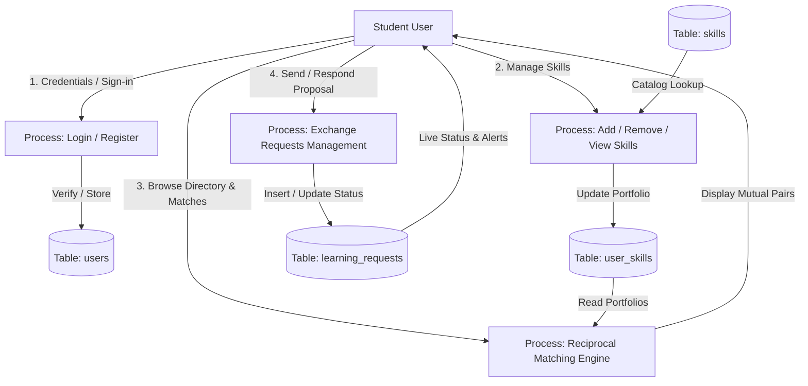
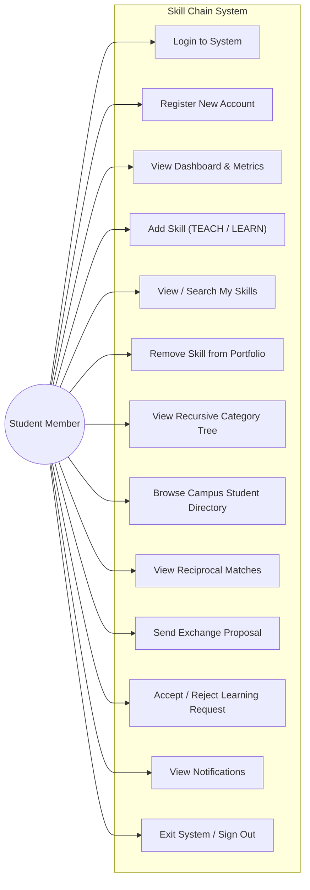
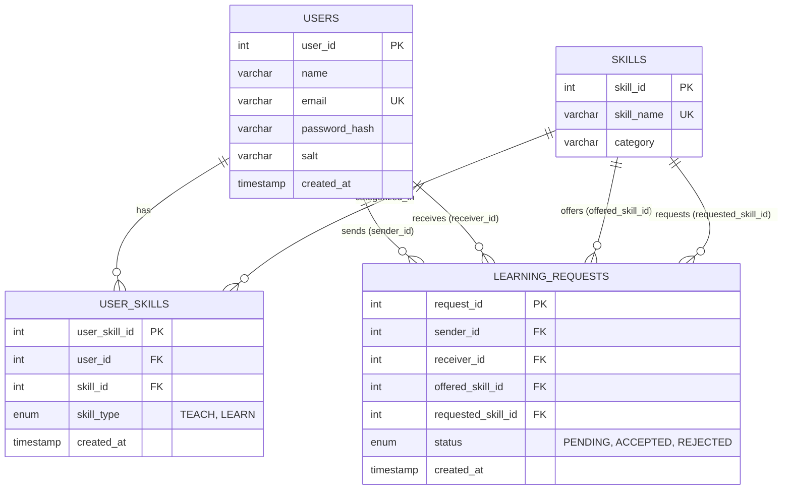

# SKILL CHAIN: CAMPUS PEER-TO-PEER SKILL EXCHANGE PLATFORM
### Integrated OOPS and DBMS project report

<br>

**Submitted by**
* **VARSHA K – 250701807**
* **VANDHANA M – 250701804**
* **VARSHINI S – 250701809**
* **VARSSINI A – 250701811**

<br>

**of**  
**BACHELOR OF ENGINEERING**  
**in**  
**Department of Computer Science and Engineering**  

<br>

**RAJALAKSHMI ENGINEERING COLLEGE, THANDALAM**  
*(An Autonomous Institution)*  

<br>

<p align="center">
  
</p>

<br>

**November 2026**

---

<br>

# RAJALAKSHMI ENGINEERING COLLEGE
## BONAFIDE CERTIFICATE

Certified that this project report titled **“SKILL CHAIN: CAMPUS PEER-TO-PEER SKILL EXCHANGE PLATFORM”** is the bonafide work of **“VARSHA K (250701807), VANDHANA M (250701804), VARSHINI S (250701809), VARSSINI A (250701811)”** who carried out the project work under my supervision.

<br><br><br>

---------------------------------------------------- &emsp;&emsp;&emsp;&emsp;&emsp;&emsp;&emsp;&emsp; ----------------------------------------------------  
**SIGNATURE** &emsp;&emsp;&emsp;&emsp;&emsp;&emsp;&emsp;&emsp;&emsp;&emsp;&emsp;&emsp;&emsp;&emsp;&emsp;&emsp;&emsp;&emsp;&emsp;&emsp;&emsp; **SIGNATURE**  
Internal Faculty Name &emsp;&emsp;&emsp;&emsp;&emsp;&emsp;&emsp;&emsp;&emsp;&emsp;&emsp;&emsp;&emsp;&emsp;&emsp;&emsp; Internal Faculty Name  
Course Incharge &emsp;&emsp;&emsp;&emsp;&emsp;&emsp;&emsp;&emsp;&emsp;&emsp;&emsp;&emsp;&emsp;&emsp;&emsp;&emsp;&emsp;&emsp; Course Incharge  
Object oriented programming system &emsp;&emsp;&emsp;&emsp;&emsp;&emsp;&emsp;&emsp;&emsp; Database management system  
Department of Computer Science and Engineering &emsp;&emsp;&emsp;&emsp; Department of Computer Science and Engineering  

<br><br><br>

---------------------------------------------------- &emsp;&emsp;&emsp;&emsp;&emsp;&emsp;&emsp;&emsp; ----------------------------------------------------  
**INTERNAL EXAMINER** &emsp;&emsp;&emsp;&emsp;&emsp;&emsp;&emsp;&emsp;&emsp;&emsp;&emsp;&emsp;&emsp;&emsp;&emsp;&emsp; **EXTERNAL EXAMINER**  

<br>

---

<br>

# ABSTRACT

In today’s world, peer learning and knowledge sharing systems are very important and essential for academic ecosystems. This management system is an application-based system, to manage students and mark their skill portfolios. Every organisation whether government, private, or academic institutions uses an information system to store and coordinate data of their members. This project is useful for providing an easy and responsive graphical user interface. 

The system uses the powerful relational database management system, data retrieval, and data manipulation. This project provides more ease for managing skill exchange data than manually maintaining and searching across disconnected chat groups. Hence it saves a lot of valuable student time. So, we can say that the project is useful for saving valuable time and reducing huge paperwork.

The main objective of this integrated project is to add, update, delete, view, search, and match student skill details. The **Skill Chain: Campus Peer-to-Peer Skill Exchange Platform** is a comprehensive solution designed to streamline and automate various aspects of peer knowledge exchange within a university campus. This project aims to develop a user-friendly and efficient desktop platform that facilitates student authentication, maintenance of teaching and learning skill portfolios, automated two-way reciprocal matchmaking, exchange request negotiations, active partnership tracking, and instant notifications.

Skill Chain captures and stores detailed student information including student names, institutional emails, salted password hashes, teaching proficiencies, and learning aspirations. This project helps in systematically organizing and querying peer data that needs to be accessed. The system was developed using foundational technologies such as **MySQL database** and **Java (JDBC)** with **Java Swing GUI**.

<br>

---

<br>

# TABLE OF CONTENTS

| CHAPTER | CONTENTS | PAGE NO. |
| :---: | :--- | :---: |
| **1** | **INTRODUCTION** | |
| | • PROBLEM STATEMENT | 5 |
| | • PROJECT OVERVIEW | 5 |
| | • PURPOSE | 5 |
| | • SCOPE | 5 |
| **2** | **FUNCTIONALITIES PROVIDED** | 6 |
| **3** | **SYSTEM FLOW DIAGRAM** | |
| | • DATAFLOW DIAGRAM | 8 |
| | • USE CASE DIAGRAM | 9 |
| | • ENTITY RELATIONSHIP DIAGRAM | 10 |
| **4** | **MODULE DESCRIPTION** | 11 |
| **5** | **IMPLEMENTATION** | |
| | • JDBC CONNECTION CODE | 12 |
| | • MAIN LAUNCHER CODE | 14 |
| | • LOGIN AND REGISTRATION PAGE | 16 |
| | • DASHBOARD AND ACTIVE PARTNERSHIPS | 21 |
| | • ADD SKILL PAGE | 26 |
| | • VIEW AND SEARCH SKILLS PAGE | 30 |
| | • DELETE SKILL PAGE | 34 |
| | • RECURSIVE CATEGORY TREE TAXONOMY | 38 |
| | • CAMPUS STUDENT DIRECTORY PAGE | 42 |
| | • RECIPROCAL MATCHING ENGINE | 46 |
| | • LEARNING REQUESTS (ACCEPT / REJECT) | 50 |
| | • NOTIFICATION CENTER | 54 |
| **6** | **CONCLUSION** | 56 |
| **7** | **REFERENCES** | 57 |

<br>

---

<br>

# - INTRODUCTION

### PROBLEM STATEMENT
On university campuses, students frequently seek to acquire specialized technical, mathematical, and design skills outside their formal syllabus. However, discovering compatible classmates who possess the desired skills and are simultaneously eager to learn what the first student can teach is extremely challenging. Informal inquiries across campus social media groups are unorganized, unindexed, lack confidentiality, and fail to calculate two-way reciprocal compatibility. An automated, centralized student skill exchange platform is required to manage student profiles, catalog skills, compute mutual matches, and track exchange agreements securely.

### PROJECT OVERVIEW
The **Skill Chain: Campus Peer-to-Peer Skill Exchange Platform** is a comprehensive solution designed to streamline and automate various aspects of peer knowledge exchange within an educational institution. This project aims to develop a user-friendly and efficient desktop platform that facilitates student authentication, maintenance of personal skill inventories (skills offered to teach and skills sought to learn), automated two-way reciprocal matchmaking, proposal requests negotiation, active partnership tracking, and real-time notification alerts.

Skill Chain captures and securely stores detailed student information including student names, verified university emails, cryptographically salted password hashes, and skill-type mappings. Through an automated relational **Reciprocal Matching Engine**, the platform pairs students when:
$$\text{Student A teaches what Student B wants to learn} \quad \land \quad \text{Student B teaches what Student A wants to learn}$$
This project helps in systematically organizing and querying student data that needs to be accessed, ensuring zero monetary cost for peer learning.

### PURPOSE
The system is aimed at total user-friendliness as well as efficient management of varied tasks:
* To centralize and organize student skill portfolios in a systematic manner and to facilitate easy access to accurate and up-to-date peer data, reducing manual errors and ensuring data integrity.
* To automate the identification of reciprocal exchange partners, eliminating days of manual inquiries.
* To provide a structured system for creating, sending, reviewing, accepting, and declining skill exchange proposals.
* To track active learning partnerships showing contact emails and mutual study obligations.
* To safeguard sensitive student credentials through cryptographically salted SHA-256 password hashing.
* To allow for potential expansion and inclusion of additional categories, ensuring the system can adapt to the evolving needs of the institution.

### SCOPE
The system is aimed at total user-friendliness as well as efficient management of different tasks:
* Capturing and storing essential student information, including student names, university emails, password hashes, and registration timestamps.
* Providing a standardized academic catalog of skills categorized into programming, web development, data & AI, and digital design.
* Allowing students to tag skills as `TEACH` (skills offered) or `LEARN` (skills sought) with duplicate prevention.
* Enabling students to browse a campus-wide student directory displaying classmates' teaching and learning portfolios, equipped with direct "Send Request ✉" action buttons.
* Executing automated dual-conditional matching queries using indexed MySQL joins.
* Managing exchange request lifecycles (`PENDING`, `ACCEPTED`, `REJECTED`) with notification indicators.
* Designing an intuitive, aesthetic desktop interface for students and administrators using Java Swing.

<br>

---

<br>

# - FUNCTIONALITIES PROVIDED

### FUNCTIONALITIES PROVIDED BY SKILL CHAIN PLATFORM:
* **Simplifying and streamlining peer skill exchanges.**
* **Provide timely notifications and remainders** for incoming requests and accepted swaps.
* **Easy to understand.**
* **Easy to access.**
* **Easy to handle.**
* **Facilitate structured learning partnerships** between university students.
* **Automate reciprocal matchmaking calculations** through relational multi-table self-joins.
* **Centralize student skill portfolios** with full CRUD (Create, Read, Update, Delete) capabilities.
* **Prevent duplicate skill registrations** through database unique constraints.
* **Safeguard student passwords** with 16-byte random salt and SHA-256 cryptographic hashing.

<br>

---

<br>

# - SYSTEM FLOW DIAGRAM

System flow diagram helps in understanding the flow of information and processes within the system. The below displays such a representation for the project on **Skill Chain: Campus Peer-to-Peer Skill Exchange Platform**.

<br>

### DATAFLOW DIAGRAM
A Data Flow Diagram (DFD) is a visual way to show how data moves through a system or process. The below displays such a representation for the project on Skill Chain.



<br>

### USE CASE DIAGRAM
A use case diagram is a visual representation that depicts the interactions between actors (users) and a system, illustrating various ways the system can be utilized or the functionalities it offers. The below displays such a representation for the project on Skill Chain.



#### Actor: Student Member Use Cases
* **Login to System – Description:** Allows an existing student to securely authenticate using registered university email and password.
* **Register New Account – Description:** Allows a new student to create a profile with verified institutional email and confirmed password.
* **View Dashboard & Metrics – Description:** Displays live metric counters for skills taught, skills learned, reciprocal matches, and exchange requests alongside active study partnerships.
* **Add Skill – Description:** Allows a student to add a new skill to their profile designated as `TEACH` or `LEARN`.
* **View / Search My Skills – Description:** Enables a student to view and filter their declared skill inventory.
* **Remove Skill – Description:** Permits a student to delete an existing skill association from their portfolio.
* **View Recursive Category Tree – Description:** Renders the academic taxonomy tree recursively.
* **Browse Campus Student Directory – Description:** Displays all registered classmates, emails, and skill portfolios with direct proposal triggers.
* **View Reciprocal Matches – Description:** Automatically calculates and displays students who share two-way teaching-learning synergy.
* **Send Exchange Proposal – Description:** Dispatches a formal exchange invitation to a classmate.
* **Accept / Reject Request – Description:** Allows receiving students to approve or decline incoming study proposals.
* **View Notifications – Description:** Opens dynamic alerts regarding accepted swaps and incoming invitations.
* **Exit System – Description:** Allows a student to log out or exit the desktop application safely.

<br>

### ENTITY RELATIONSHIP DIAGRAM
An entity-relationship diagram (ERD) is a visual representation illustrating the relationships between different entities within a database system. The below displays such a representation for the project on Skill Chain.



<br>

---

<br>

# - MODULE DESCRIPTION

The different types of modules present in this project are:

### LOGIN & REGISTRATION MODULE:
In this section, students can sign in or register new accounts. During registration, the student's name, email, and confirmed password are validated. A cryptographically secure 16-byte random salt is generated, and a 64-character SHA-256 hash is computed. During login, candidate credentials are verified using constant-time comparison to protect against timing attacks.

### STUDENT DASHBOARD & ACTIVE PARTNERSHIPS MODULE:
In this section, students can view their primary summary dashboard. Four elevated metric cards display live counters for: *Skills I Teach*, *Skills I Learn*, *Reciprocal Matches*, and *Exchange Requests*. An *Active Learning Status Tracker* displays all accepted study partnerships showing classmate contact details and learning commitments.

### ADD SKILL MODULE:
In this section, students can add skills to their portfolio. The student selects a skill from the standardized catalog (or enters a custom skill) and tags it as `TEACH` (Offering to mentor) or `LEARN` (Seeking to acquire). While adding the skill into the list, the system checks for uniqueness to prevent duplicate skill-type records.

### VIEW & SEARCH SKILLS MODULE:
In this section, students can view their current skill inventory. A formatted table displays skill ID, skill name, category, exchange type (`TEACH` in green, `LEARN` in blue), and date added. A search bar and category dropdown allow students to filter their portfolio dynamically.

### DELETE SKILL MODULE:
In this section, students can delete a skill from their portfolio. The system verifies that the student owns the record before deleting it from MySQL, ensuring cascade safety and immediate dashboard metric recalculation.

### RECURSIVE CATEGORY TREE TAXONOMY MODULE:
In this section, students can view the hierarchical taxonomy of academic skills. The system builds an N-ary tree data structure and utilizes a recursive algorithm to traverse and print nested domains, subdomains, and skills with clean indentations.

### CAMPUS STUDENT DIRECTORY MODULE:
In this section, students can browse all registered classmates across campus. Each classmate card displays their name, university email, skills they teach, skills they want to learn, and an immediate **"Send Request ✉"** button.

### RECIPROCAL MATCHING ENGINE MODULE:
In this section, the system executes an automated 4-table relational self-join query to identify two-way mutual matches where Student A teaches what Student B seeks, and Student B teaches what Student A seeks.

### LEARNING REQUESTS MODULE:
In this section, students can manage incoming and outgoing exchange proposals. Students can click **"Accept ✓"** to confirm an active partnership or **"Reject ✕"** to decline a proposal.

### NOTIFICATION CENTER MODULE:
In this section, a top-bar notification bell displays unread counts and opens a modal dialog listing recent alerts regarding accepted swaps and incoming requests.

<br>

---

<br>

# - IMPLEMENTATION

<br>

### JDBC CONNECTION CODE :
`DatabaseConnection.java` establishes secure JDBC database connectivity using credentials stored in external `config.properties`.

```java
package com.skillchain.util;

import java.io.File;
import java.io.FileInputStream;
import java.io.InputStream;
import java.sql.Connection;
import java.sql.DriverManager;
import java.sql.SQLException;
import java.util.Properties;

public final class DatabaseConnection {

    private static final String CONFIG_FILE_NAME = "config.properties";
    private static String dbUrl;
    private static String dbUser;
    private static String dbPassword;
    private static boolean initialized = false;

    private DatabaseConnection() {}

    private static synchronized void initialize() {
        if (initialized) return;

        Properties properties = new Properties();
        File externalConfigFile = new File(CONFIG_FILE_NAME);

        try {
            if (externalConfigFile.exists()) {
                try (InputStream fis = new FileInputStream(externalConfigFile)) {
                    properties.load(fis);
                }
            } else {
                try (InputStream cis = DatabaseConnection.class.getClassLoader().getResourceAsStream(CONFIG_FILE_NAME)) {
                    if (cis != null) {
                        properties.load(cis);
                    } else {
                        throw new DatabaseException("Configuration file 'config.properties' not found!");
                    }
                }
            }

            dbUrl = properties.getProperty("db.url");
            dbUser = properties.getProperty("db.user");
            dbPassword = properties.getProperty("db.password", "");

            Class.forName("com.mysql.cj.jdbc.Driver");
            initialized = true;

        } catch (Exception e) {
            throw new DatabaseException("Failed to read database configuration: " + e.getMessage(), e);
        }
    }

    public static Connection getConnection() throws SQLException {
        if (!initialized) {
            initialize();
        }
        return DriverManager.getConnection(dbUrl, dbUser, dbPassword);
    }

    public static boolean testConnection() {
        try (Connection conn = getConnection()) {
            return conn != null && !conn.isClosed();
        } catch (Exception e) {
            return false;
        }
    }
}
```

<br>

### MAIN LAUNCHER CODE :
`Main.java` boots the application on the Swing Event Dispatch Thread.

```java
package com.skillchain;

import com.skillchain.ui.LoginRegisterFrame;
import javax.swing.SwingUtilities;
import javax.swing.UIManager;

public class Main {
    public static void main(String[] args) {
        SwingUtilities.invokeLater(() -> {
            try {
                UIManager.setLookAndFeel(UIManager.getSystemLookAndFeelClassName());
            } catch (Exception ignored) {}
            new LoginRegisterFrame().setVisible(true);
        });
    }
}
```

<br>

---

<br>

### LOGIN PAGE :

<p align="center">
  
</p>

```java
package com.skillchain.ui;

import com.skillchain.model.User;
import com.skillchain.service.UserService;
import com.skillchain.util.InvalidLoginException;
import javax.swing.*;
import java.awt.*;
import java.awt.event.ActionEvent;
import java.awt.event.ActionListener;

public class LoginPanel extends JPanel implements ActionListener {
    private ModernTextField txtLoginEmail;
    private ModernPasswordField txtLoginPassword;
    private ModernButton btnLogin;
    private final UserService userService = new UserService();
    private final JFrame parentFrame;

    public LoginPanel(JFrame parentFrame) {
        this.parentFrame = parentFrame;
        setLayout(new BoxLayout(this, BoxLayout.Y_AXIS));
        setOpaque(false);

        JLabel lblEmail = new JLabel("University Email");
        lblEmail.setFont(new Font("Segoe UI", Font.BOLD, 13));
        add(lblEmail);

        txtLoginEmail = new ModernTextField();
        add(txtLoginEmail);

        JLabel lblPass = new JLabel("Password");
        lblPass.setFont(new Font("Segoe UI", Font.BOLD, 13));
        add(lblPass);

        txtLoginPassword = new ModernPasswordField();
        add(txtLoginPassword);

        btnLogin = new ModernButton("Sign In to Skill Chain", ModernButton.ButtonStyle.PRIMARY);
        btnLogin.addActionListener(this);
        add(btnLogin);
    }

    @Override
    public void actionPerformed(ActionEvent e) {
        String email = txtLoginEmail.getText().trim();
        String password = new String(txtLoginPassword.getPassword());

        try {
            User user = userService.login(email, password);
            JOptionPane.showMessageDialog(parentFrame, "Login Successful! Welcome, " + user.getName(), 
                                          "Success", JOptionPane.INFORMATION_MESSAGE);
            new MainFrame(user, parentFrame).setVisible(true);
            parentFrame.setVisible(false);
        } catch (InvalidLoginException ex) {
            JOptionPane.showMessageDialog(parentFrame, ex.getMessage(), "Authentication Failed", JOptionPane.ERROR_MESSAGE);
        } catch (Exception ex) {
            JOptionPane.showMessageDialog(parentFrame, "Database Connection Error: " + ex.getMessage(), "Error", JOptionPane.ERROR_MESSAGE);
        }
    }
}
```

#### JDBC QUERY CODE (AUTHENTICATION):
```sql
-- User Lookup query executed in UserDaoImpl.java:
SELECT user_id, name, email, password_hash, salt, created_at 
FROM users 
WHERE LOWER(email) = ?;
```

<br>

---

<br>

### REGISTRATION PAGE :

<p align="center">
  
</p>

```java
package com.skillchain.ui;

import com.skillchain.model.User;
import com.skillchain.service.UserService;
import com.skillchain.util.DuplicateEmailException;
import javax.swing.*;
import java.awt.event.ActionEvent;
import java.awt.event.ActionListener;

public class RegisterPanel extends JPanel implements ActionListener {
    private ModernTextField txtRegName, txtRegEmail;
    private ModernPasswordField txtRegPassword, txtRegConfirmPassword;
    private ModernButton btnRegister;
    private final UserService userService = new UserService();
    private final JFrame parentFrame;

    public RegisterPanel(JFrame parentFrame) {
        this.parentFrame = parentFrame;
        setLayout(new BoxLayout(this, BoxLayout.Y_AXIS));
        setOpaque(false);

        add(new JLabel("Full Name"));
        txtRegName = new ModernTextField();
        add(txtRegName);

        add(new JLabel("University Email"));
        txtRegEmail = new ModernTextField();
        add(txtRegEmail);

        add(new JLabel("Password"));
        txtRegPassword = new ModernPasswordField();
        add(txtRegPassword);

        add(new JLabel("Confirm Password"));
        txtRegConfirmPassword = new ModernPasswordField();
        add(txtRegConfirmPassword);

        btnRegister = new ModernButton("Create Student Account", ModernButton.ButtonStyle.PRIMARY);
        btnRegister.addActionListener(this);
        add(btnRegister);
    }

    @Override
    public void actionPerformed(ActionEvent e) {
        String name = txtRegName.getText().trim();
        String email = txtRegEmail.getText().trim();
        String pass = new String(txtRegPassword.getPassword());
        String confirm = new String(txtRegConfirmPassword.getPassword());

        if (!pass.equals(confirm)) {
            JOptionPane.showMessageDialog(parentFrame, "Passwords do not match!", "Validation Error", JOptionPane.ERROR_MESSAGE);
            return;
        }

        try {
            User newUser = userService.register(name, email, pass);
            JOptionPane.showMessageDialog(parentFrame, "Student Account Created Successfully! Please Sign In.", 
                                          "Success", JOptionPane.INFORMATION_MESSAGE);
            txtRegPassword.setText("");
            txtRegConfirmPassword.setText("");
        } catch (DuplicateEmailException ex) {
            JOptionPane.showMessageDialog(parentFrame, ex.getMessage(), "Duplicate Account", JOptionPane.ERROR_MESSAGE);
        } catch (Exception ex) {
            JOptionPane.showMessageDialog(parentFrame, "Error: " + ex.getMessage(), "Error", JOptionPane.ERROR_MESSAGE);
        }
    }
}
```

#### JDBC INSERT CODE (REGISTRATION):
```sql
-- User Insert with Salted SHA-256 Hash executed in UserDaoImpl.java:
INSERT INTO users (name, email, password_hash, salt) 
VALUES (?, ?, ?, ?);
```

<br>

---

<br>

### DASHBOARD PAGE :

<p align="center">
  
</p>

```java
package com.skillchain.ui;

import com.skillchain.model.ActivePartnership;
import com.skillchain.model.User;
import com.skillchain.service.RequestService;
import com.skillchain.service.SkillService;
import javax.swing.*;
import javax.swing.border.EmptyBorder;
import java.awt.*;
import java.util.List;

public class DashboardPanel extends JPanel {
    private final User currentUser;
    private final SkillService skillService = new SkillService();
    private final RequestService requestService = new RequestService();

    private JLabel lblDashTeach, lblDashLearn, lblDashMatches, lblDashRequests;
    private JPanel activePartnershipsContainer;

    public DashboardPanel(User user) {
        this.currentUser = user;
        setLayout(new BorderLayout(0, 20));
        setBackground(new Color(248, 250, 252));
        setBorder(new EmptyBorder(24, 24, 24, 24));

        // Metric KPI Grid
        JPanel metricsGrid = new JPanel(new GridLayout(1, 4, 16, 0));
        metricsGrid.setOpaque(false);
        metricsGrid.add(createMetricCard("Skills I Teach", lblDashTeach = new JLabel("0"), new Color(5, 150, 105)));
        metricsGrid.add(createMetricCard("Skills I Learn", lblDashLearn = new JLabel("0"), new Color(37, 99, 235)));
        metricsGrid.add(createMetricCard("Reciprocal Matches", lblDashMatches = new JLabel("0"), new Color(217, 119, 6)));
        metricsGrid.add(createMetricCard("Exchange Requests", lblDashRequests = new JLabel("0"), new Color(147, 51, 234)));
        add(metricsGrid, BorderLayout.NORTH);

        // Active Partnerships Section
        activePartnershipsContainer = new JPanel();
        activePartnershipsContainer.setLayout(new BoxLayout(activePartnershipsContainer, BoxLayout.Y_AXIS));
        activePartnershipsContainer.setBackground(Color.WHITE);
        add(new JScrollPane(activePartnershipsContainer), BorderLayout.CENTER);
    }

    private JPanel createMetricCard(String title, JLabel valueLabel, Color accentColor) {
        JPanel card = new JPanel(new BorderLayout());
        card.setBackground(Color.WHITE);
        card.setBorder(BorderFactory.createCompoundBorder(
            BorderFactory.createLineBorder(new Color(226, 232, 240), 1),
            new EmptyBorder(16, 18, 16, 18)
        ));
        JLabel lblTitle = new JLabel(title);
        lblTitle.setFont(new Font("Segoe UI", Font.BOLD, 12));
        lblTitle.setForeground(new Color(100, 116, 139));
        valueLabel.setFont(new Font("Segoe UI", Font.BOLD, 28));
        valueLabel.setForeground(accentColor);
        card.add(lblTitle, BorderLayout.NORTH);
        card.add(valueLabel, BorderLayout.CENTER);
        return card;
    }
}
```

#### JDBC QUERY CODE (ACTIVE PARTNERSHIPS):
```sql
-- Querying accepted ongoing learning partnerships:
SELECT lr.request_id,
       CASE WHEN lr.sender_id = ? THEN u_recv.name ELSE u_send.name END AS partner_name,
       CASE WHEN lr.sender_id = ? THEN u_recv.email ELSE u_send.email END AS partner_email,
       CASE WHEN lr.sender_id = ? THEN s_off.skill_name ELSE s_req.skill_name END AS you_teach,
       CASE WHEN lr.sender_id = ? THEN s_req.skill_name ELSE s_off.skill_name END AS partner_teaches,
       lr.status, lr.created_at
FROM learning_requests lr
JOIN users u_send ON lr.sender_id = u_send.user_id
JOIN users u_recv ON lr.receiver_id = u_recv.user_id
JOIN skills s_off ON lr.offered_skill_id = s_off.skill_id
JOIN skills s_req ON lr.requested_skill_id = s_req.skill_id
WHERE (lr.sender_id = ? OR lr.receiver_id = ?) AND lr.status = 'ACCEPTED'
ORDER BY lr.created_at DESC;
```

<br>

---

<br>

### ADD SKILL PAGE :

<p align="center">
  
</p>

```java
package com.skillchain.ui;

import com.skillchain.model.Skill;
import com.skillchain.model.SkillType;
import com.skillchain.service.SkillService;
import com.skillchain.util.DuplicateSkillException;
import javax.swing.*;
import java.awt.event.ActionEvent;
import java.awt.event.ActionListener;
import java.util.List;

public class AddSkillDialog extends JDialog implements ActionListener {
    private JComboBox<String> cmbSkills;
    private JRadioButton rbTeach, rbLearn;
    private JButton btnAdd, btnCancel;
    private final SkillService skillService = new SkillService();
    private final int userId;
    private final Runnable onSuccessCallback;

    public AddSkillDialog(JFrame parent, int userId, Runnable onSuccessCallback) {
        super(parent, "Add Skill to Portfolio", true);
        this.userId = userId;
        this.onSuccessCallback = onSuccessCallback;
        setSize(420, 280);
        setLocationRelativeTo(parent);
        setLayout(new BoxLayout(getContentPane(), BoxLayout.Y_AXIS));

        add(new JLabel("Select Skill:"));
        cmbSkills = new JComboBox<>();
        loadSkillCatalog();
        add(cmbSkills);

        add(new JLabel("Exchange Intent:"));
        rbTeach = new JRadioButton("I can TEACH this skill", true);
        rbLearn = new JRadioButton("I want to LEARN this skill");
        ButtonGroup bg = new ButtonGroup();
        bg.add(rbTeach);
        bg.add(rbLearn);
        add(rbTeach);
        add(rbLearn);

        btnAdd = new JButton("Add Skill");
        btnAdd.addActionListener(this);
        add(btnAdd);
    }

    private void loadSkillCatalog() {
        try {
            List<Skill> catalog = skillService.getAllCatalogSkills();
            for (Skill s : catalog) {
                cmbSkills.addItem(s.getSkillName());
            }
        } catch (Exception ex) {
            ex.printStackTrace();
        }
    }

    @Override
    public void actionPerformed(ActionEvent e) {
        String skillName = (String) cmbSkills.getSelectedItem();
        SkillType type = rbTeach.isSelected() ? SkillType.TEACH : SkillType.LEARN;

        try {
            skillService.addSkillToUser(userId, skillName, type);
            JOptionPane.showMessageDialog(this, "Skill added successfully!", "Success", JOptionPane.INFORMATION_MESSAGE);
            if (onSuccessCallback != null) onSuccessCallback.run();
            dispose();
        } catch (DuplicateSkillException ex) {
            JOptionPane.showMessageDialog(this, ex.getMessage(), "Duplicate Skill", JOptionPane.WARNING_MESSAGE);
        } catch (Exception ex) {
            JOptionPane.showMessageDialog(this, "Error: " + ex.getMessage(), "Database Error", JOptionPane.ERROR_MESSAGE);
        }
    }
}
```

#### JDBC INSERT CODE (ADD SKILL):
```sql
-- Inserting user skill mapping into junction table:
INSERT INTO user_skills (user_id, skill_id, skill_type) 
VALUES (?, ?, ?);
```

<br>

---

<br>

### VIEW AND SEARCH SKILLS PAGE :

<p align="center">
  
</p>

```java
package com.skillchain.ui;

import com.skillchain.model.UserSkill;
import com.skillchain.service.SkillService;
import javax.swing.*;
import javax.swing.table.DefaultTableModel;
import java.util.List;

public class SkillTableManager {
    private final JTable tblSkills;
    private final DefaultTableModel tableModel;
    private final SkillService skillService = new SkillService();

    public SkillTableManager(JTable table, DefaultTableModel model) {
        this.tblSkills = table;
        this.tableModel = model;
    }

    public void loadSkills(int userId, String keywordFilter) {
        try {
            List<UserSkill> skills = skillService.getUserSkills(userId);
            tableModel.setRowCount(0);

            for (UserSkill us : skills) {
                if (keywordFilter != null && !keywordFilter.isEmpty()) {
                    if (!us.getSkillName().toLowerCase().contains(keywordFilter.toLowerCase()) &&
                        !us.getCategory().toLowerCase().contains(keywordFilter.toLowerCase())) {
                        continue;
                    }
                }

                tableModel.addRow(new Object[]{
                    us.getUserSkillId(),
                    us.getSkillName(),
                    us.getCategory(),
                    us.getSkillType().name(),
                    us.getCreatedAt() != null ? us.getCreatedAt().toString() : "N/A"
                });
            }
        } catch (Exception ex) {
            ex.printStackTrace();
        }
    }
}
```

#### JDBC SELECT CODE (VIEW SKILLS):
```sql
-- Querying personal skill portfolio with category join:
SELECT us.user_skill_id, us.user_id, us.skill_id, s.skill_name, s.category, 
       us.skill_type, us.created_at 
FROM user_skills us 
JOIN skills s ON us.skill_id = s.skill_id 
WHERE us.user_id = ? 
ORDER BY us.skill_type ASC, s.skill_name ASC;
```

<br>

---

<br>

### DELETE SKILL PAGE :

<p align="center">
  
</p>

```java
package com.skillchain.ui;

import com.skillchain.service.SkillService;
import javax.swing.*;

public class SkillDeleteHandler {
    private final SkillService skillService = new SkillService();

    public void handleDeleteSkill(JFrame parent, JTable tblSkills, int userId, Runnable onDeletedCallback) {
        int selectedRow = tblSkills.getSelectedRow();
        if (selectedRow == -1) {
            JOptionPane.showMessageDialog(parent, "Please select a skill from the table to remove.", 
                                          "No Skill Selected", JOptionPane.WARNING_MESSAGE);
            return;
        }

        int userSkillId = (int) tblSkills.getValueAt(selectedRow, 0);
        String skillName = (String) tblSkills.getValueAt(selectedRow, 1);

        int confirm = JOptionPane.showConfirmDialog(parent, 
            "Are you sure you want to remove '" + skillName + "' from your portfolio?", 
            "Confirm Deletion", JOptionPane.YES_NO_OPTION);

        if (confirm == JOptionPane.YES_OPTION) {
            try {
                skillService.removeSkillFromUser(userSkillId, userId);
                JOptionPane.showMessageDialog(parent, "Skill removed successfully!", "Success", JOptionPane.INFORMATION_MESSAGE);
                if (onDeletedCallback != null) onDeletedCallback.run();
            } catch (Exception ex) {
                JOptionPane.showMessageDialog(parent, "Failed to remove skill: " + ex.getMessage(), "Database Error", JOptionPane.ERROR_MESSAGE);
            }
        }
    }
}
```

#### JDBC DELETE CODE (DELETE SKILL):
```sql
-- Enforcing ownership during deletion:
DELETE FROM user_skills 
WHERE user_skill_id = ? AND user_id = ?;
```

<br>

---

<br>

### RECURSIVE CATEGORY TREE TAXONOMY :

<p align="center">
  
</p>

```java
package com.skillchain.util;

import com.skillchain.model.SkillCategoryNode;

public final class SkillTreeUtil {
    // RECURSION IMPLEMENTATION: Depth-First Search tree traversal
    public static void traverseTreeRecursive(SkillCategoryNode node, int depth, StringBuilder buffer) {
        if (node == null) return; // Base Case

        String indent = "   ".repeat(depth);
        buffer.append(indent).append("📂 ").append(node.getName()).append("
");

        for (String skill : node.getSkills()) {
            buffer.append(indent).append("   ├── ⚡ ").append(skill).append("
");
        }

        // Recursive Step: Process child categories
        for (SkillCategoryNode child : node.getChildren()) {
            traverseTreeRecursive(child, depth + 1, buffer);
        }
    }
}
```

<br>

---

<br>

### CAMPUS STUDENT DIRECTORY PAGE :

<p align="center">
  
</p>

```java
package com.skillchain.ui;

import com.skillchain.model.PeerStudent;
import com.skillchain.service.RequestService;
import javax.swing.*;
import java.awt.*;
import java.util.List;

public class PeerDirectoryPanel extends JPanel {
    private final RequestService requestService = new RequestService();
    private final int currentUserId;

    public PeerDirectoryPanel(int userId) {
        this.currentUserId = userId;
        setLayout(new BoxLayout(this, BoxLayout.Y_AXIS));
        setBackground(new Color(248, 250, 252));
    }

    public void loadPeers() {
        removeAll();
        try {
            List<PeerStudent> peers = requestService.getPeerDirectory(currentUserId);
            for (PeerStudent peer : peers) {
                JPanel card = new JPanel(new BorderLayout());
                card.setBackground(Color.WHITE);
                card.setBorder(BorderFactory.createCompoundBorder(
                    BorderFactory.createLineBorder(new Color(226, 232, 240), 1),
                    BorderFactory.createEmptyBorder(12, 16, 12, 16)
                ));

                JLabel lblName = new JLabel(peer.getName() + " (" + peer.getEmail() + ")");
                lblName.setFont(new Font("Segoe UI", Font.BOLD, 14));

                JLabel lblSkills = new JLabel("Teaches: " + peer.getTeachingSkills() + " | Seeks: " + peer.getLearningSkills());
                lblSkills.setFont(new Font("Segoe UI", Font.PLAIN, 12));
                lblSkills.setForeground(new Color(100, 116, 139));

                JButton btnSend = new JButton("Send Request ✉");
                btnSend.setBackground(new Color(37, 99, 235));
                btnSend.setForeground(Color.WHITE);

                card.add(lblName, BorderLayout.NORTH);
                card.add(lblSkills, BorderLayout.CENTER);
                card.add(btnSend, BorderLayout.EAST);
                add(card);
                add(Box.createRigidArea(new Dimension(0, 8)));
            }
            revalidate();
            repaint();
        } catch (Exception ex) {
            ex.printStackTrace();
        }
    }
}
```

#### JDBC QUERY CODE (STUDENT DIRECTORY WITH AGGREGATED SKILLS):
```sql
-- Aggregating peer student emails and skills using GROUP_CONCAT:
SELECT u.user_id, u.name, u.email,
       COALESCE(GROUP_CONCAT(DISTINCT CASE WHEN us.skill_type = 'TEACH' THEN s.skill_name END SEPARATOR ', '), 'None listed yet') AS teach_skills,
       COALESCE(GROUP_CONCAT(DISTINCT CASE WHEN us.skill_type = 'LEARN' THEN s.skill_name END SEPARATOR ', '), 'None listed yet') AS learn_skills
FROM users u
LEFT JOIN user_skills us ON u.user_id = us.user_id
LEFT JOIN skills s ON us.skill_id = s.skill_id
WHERE u.user_id != ?
GROUP BY u.user_id, u.name, u.email
ORDER BY u.name ASC;
```

<br>

---

<br>

### RECIPROCAL MATCHING ENGINE :

<p align="center">
  
</p>

```java
package com.skillchain.service;

import com.skillchain.model.ReciprocalMatch;
import com.skillchain.util.DatabaseConnection;
import java.sql.Connection;
import java.sql.PreparedStatement;
import java.sql.ResultSet;
import java.sql.SQLException;
import java.util.ArrayList;
import java.util.List;

public class MatchingService {

    private static final String RECIPROCAL_MATCH_SQL =
        "SELECT " +
        "    u_partner.user_id AS partner_id, " +
        "    u_partner.name AS partner_name, " +
        "    u_partner.email AS partner_email, " +
        "    s_offer.skill_id AS user_offered_id, " +
        "    s_offer.skill_name AS user_offered_name, " +
        "    s_partner.skill_id AS partner_offered_id, " +
        "    s_partner.skill_name AS partner_offered_name " +
        "FROM user_skills my_teach " +
        "JOIN user_skills partner_learn " +
        "    ON my_teach.skill_id = partner_learn.skill_id " +
        "   AND my_teach.skill_type = 'TEACH' " +
        "   AND partner_learn.skill_type = 'LEARN' " +
        "   AND partner_learn.user_id != my_teach.user_id " +
        "JOIN user_skills partner_teach " +
        "    ON partner_teach.user_id = partner_learn.user_id " +
        "   AND partner_teach.skill_type = 'TEACH' " +
        "JOIN user_skills my_learn " +
        "    ON my_learn.skill_id = partner_teach.skill_id " +
        "   AND my_learn.user_id = my_teach.user_id " +
        "   AND my_learn.skill_type = 'LEARN' " +
        "JOIN users u_partner ON u_partner.user_id = partner_learn.user_id " +
        "JOIN skills s_offer ON s_offer.skill_id = my_teach.skill_id " +
        "JOIN skills s_partner ON s_partner.skill_id = partner_teach.skill_id " +
        "WHERE my_teach.user_id = ? " +
        "ORDER BY u_partner.name ASC";

    public List<ReciprocalMatch> findReciprocalMatches(int currentUserId) throws SQLException {
        List<ReciprocalMatch> matches = new ArrayList<>();

        try (Connection conn = DatabaseConnection.getConnection();
             PreparedStatement stmt = conn.prepareStatement(RECIPROCAL_MATCH_SQL)) {

            stmt.setInt(1, currentUserId);

            try (ResultSet rs = stmt.executeQuery()) {
                while (rs.next()) {
                    matches.add(new ReciprocalMatch(
                        rs.getInt("partner_id"),
                        rs.getString("partner_name"),
                        rs.getString("partner_email"),
                        rs.getInt("user_offered_id"),
                        rs.getString("user_offered_name"),
                        "",
                        rs.getInt("partner_offered_id"),
                        rs.getString("partner_offered_name"),
                        ""
                    ));
                }
            }
        }
        return matches;
    }
}
```

#### JDBC 4-TABLE RELATIONAL SELF-JOIN CODE:
```sql
-- Dual-conditional mutual matching relational query:
SELECT u_partner.user_id AS partner_id,
       u_partner.name AS partner_name,
       u_partner.email AS partner_email,
       s_offer.skill_name AS you_teach,
       s_partner.skill_name AS partner_teaches
FROM user_skills my_teach
JOIN user_skills partner_learn 
    ON my_teach.skill_id = partner_learn.skill_id 
   AND my_teach.skill_type = 'TEACH' 
   AND partner_learn.skill_type = 'LEARN' 
   AND partner_learn.user_id != my_teach.user_id
JOIN user_skills partner_teach 
    ON partner_teach.user_id = partner_learn.user_id 
   AND partner_teach.skill_type = 'TEACH'
JOIN user_skills my_learn 
    ON my_learn.skill_id = partner_teach.skill_id 
   AND my_learn.user_id = my_teach.user_id 
   AND my_learn.skill_type = 'LEARN'
JOIN users u_partner ON u_partner.user_id = partner_learn.user_id
JOIN skills s_offer ON s_offer.skill_id = my_teach.skill_id
JOIN skills s_partner ON s_partner.skill_id = partner_teach.skill_id
WHERE my_teach.user_id = ?
ORDER BY u_partner.name ASC;
```

<br>

---

<br>

### LEARNING REQUESTS (ACCEPT / REJECT) :

<p align="center">
  
</p>

<p align="center">
  
</p>

```java
package com.skillchain.ui;

import com.skillchain.service.RequestService;
import javax.swing.*;

public class RequestStatusHandler {
    private final RequestService requestService = new RequestService();

    public void handleAccept(JFrame parent, int requestId, Runnable onUpdatedCallback) {
        int confirm = JOptionPane.showConfirmDialog(parent, "Accept this skill exchange proposal?", 
                                                    "Confirm Partnership", JOptionPane.YES_NO_OPTION);
        if (confirm == JOptionPane.YES_OPTION) {
            try {
                requestService.acceptRequest(requestId);
                JOptionPane.showMessageDialog(parent, "Proposal Accepted! Active Partnership Established.", 
                                              "Success", JOptionPane.INFORMATION_MESSAGE);
                if (onUpdatedCallback != null) onUpdatedCallback.run();
            } catch (Exception ex) {
                JOptionPane.showMessageDialog(parent, "Error updating status: " + ex.getMessage(), 
                                              "Database Error", JOptionPane.ERROR_MESSAGE);
            }
        }
    }

    public void handleReject(JFrame parent, int requestId, Runnable onUpdatedCallback) {
        int confirm = JOptionPane.showConfirmDialog(parent, "Decline this skill exchange proposal?", 
                                                    "Decline Proposal", JOptionPane.YES_NO_OPTION);
        if (confirm == JOptionPane.YES_OPTION) {
            try {
                requestService.rejectRequest(requestId);
                JOptionPane.showMessageDialog(parent, "Proposal Declined.", "Updated", JOptionPane.INFORMATION_MESSAGE);
                if (onUpdatedCallback != null) onUpdatedCallback.run();
            } catch (Exception ex) {
                JOptionPane.showMessageDialog(parent, "Error updating status: " + ex.getMessage(), 
                                              "Database Error", JOptionPane.ERROR_MESSAGE);
            }
        }
    }
}
```

#### JDBC UPDATE CODE (ACCEPT / REJECT):
```sql
-- Updating exchange request status:
UPDATE learning_requests 
SET status = ? 
WHERE request_id = ?;
```

<br>

---

<br>

### NOTIFICATION CENTER :

<p align="center">
  
</p>

```java
package com.skillchain.ui;

import com.skillchain.model.AppNotification;
import com.skillchain.service.RequestService;
import javax.swing.*;
import java.awt.*;
import java.util.List;

public class NotificationDialog extends JDialog {
    private final RequestService requestService = new RequestService();

    public NotificationDialog(JFrame parent, int userId) {
        super(parent, "Notification Center", true);
        setSize(520, 400);
        setLocationRelativeTo(parent);
        setLayout(new BorderLayout());

        JPanel container = new JPanel();
        container.setLayout(new BoxLayout(container, BoxLayout.Y_AXIS));
        container.setBackground(Color.WHITE);

        try {
            List<AppNotification> notifications = requestService.getNotifications(userId);
            if (notifications.isEmpty()) {
                container.add(new JLabel("No new notifications at this time."));
            } else {
                for (AppNotification n : notifications) {
                    JPanel p = new JPanel(new BorderLayout());
                    p.setBorder(BorderFactory.createCompoundBorder(
                        BorderFactory.createLineBorder(new Color(226, 232, 240), 1),
                        BorderFactory.createEmptyBorder(8, 12, 8, 12)
                    ));
                    JLabel title = new JLabel(n.getTitle());
                    title.setFont(new Font("Segoe UI", Font.BOLD, 13));
                    JLabel msg = new JLabel("<html>" + n.getMessage() + "</html>");
                    msg.setFont(new Font("Segoe UI", Font.PLAIN, 12));
                    p.add(title, BorderLayout.NORTH);
                    p.add(msg, BorderLayout.CENTER);
                    container.add(p);
                    container.add(Box.createRigidArea(new Dimension(0, 6)));
                }
            }
        } catch (Exception ex) {
            ex.printStackTrace();
        }

        add(new JScrollPane(container), BorderLayout.CENTER);
    }
}
```

<br>

---

<br>

# - CONCLUSION

In conclusion, our student skill exchange database management system implemented in Java using JDBC successfully addresses the core functionalities of adding new skills, removing records, updating statuses, and efficiently retrieving data when needed. The utilization of **JDBC (Java Database Connectivity)** allowed seamless interaction between the Java application and the MySQL database engine, ensuring robust data management and transaction security.

The project emphasized the importance of adopting core **Object-Oriented Programming (OOPS)** principles:
* **Abstraction:** separating interface contracts from database implementations (`Person.java`, `Searchable.java`).
* **Inheritance:** modeling domain users cleanly through base class reuse (`User.java`, `PeerStudent.java`).
* **Encapsulation:** defensive input validation and getter/setter boundaries across all models.
* **Polymorphism:** compile-time method overloading (`search()`, `getUserSkills()`) and runtime dynamic method overriding (`getRole()`, `getSummary()`).
* **Data Structures & Recursion:** traversing nested academic category trees using depth-first recursive algorithms.
* **Application Security:** cryptographically salted SHA-256 password hashing.

Additionally, the project's reliance on established database management principles, as outlined in key texts, ensured a solid foundation for data integrity, 3rd Normal Form (3NF) relational design, referential cascading constraints, and multi-table join query optimization.

Through this project, we gained valuable insights into Java application development, database connectivity, and the significance of adhering to best practices in software design. The system provides a user-friendly interface for managing student skill portfolios, contributing to a more efficient and collaborative peer learning process on campus.

<br>

---

<br>

# - REFERENCES

* **JAVA – The Complete Reference** by ORACLE Press / Herbert Schildt.
* **Database System Concepts** by Abraham Silberschatz, Henry F. Korth, and S. Sudarshan (McGraw-Hill).
* **MySQL 8.0 Reference Manual** – Oracle Corporation.
* **YouTube Playlist & Video Tutorials on Java JDBC Swing Architecture:**  
  https://www.youtube.com/playlist?list=PLbKub4Jss9oUbTmeS9li_DoskYCiuvx1R
