# 🎓 SKILL CHAIN: Campus Peer-to-Peer Skill Exchange Platform
## Final Project Report for Object-Oriented Programming (OOP) and Database Management Systems (DBMS)

---

### **PRELIMINARY PAGES**

---

#### **BONAFIDE CERTIFICATE**

Certified that this project report titled **"SKILL CHAIN: A Peer-to-Peer Skill Exchange Platform for University Students"** is the bonafide work of:

1. Name: __________________________________________________ &emsp;&emsp; Register No: ____________________________  
2. Name: __________________________________________________ &emsp;&emsp; Register No: ____________________________  

who carried out the project under my supervision for the fulfillment of the requirements in **Object-Oriented Programming (Java)** and **Database Management Systems (MySQL)** during the Academic Year 2025–2026.

<br><br>

--------------------------------------------- &emsp;&emsp;&emsp;&emsp;&emsp;&emsp;&emsp;&emsp;&emsp;&emsp;&emsp;&emsp; ---------------------------------------------  
**SUPERVISOR / FACULTY IN-CHARGE** &emsp;&emsp;&emsp;&emsp;&emsp;&emsp;&emsp;&emsp;&emsp;&emsp; **HEAD OF THE DEPARTMENT**  
Department of Computer Science and Engineering &emsp;&emsp;&emsp;&emsp;&emsp;&emsp; Department of Computer Science and Engineering  
College / Institute of Engineering & Technology &emsp;&emsp;&emsp;&emsp;&emsp;&emsp;&emsp;&emsp; College / Institute of Engineering & Technology  

<br>

---

#### **STUDENT DECLARATION**

We / I, ____________________________________________________________________________________, hereby declare that the project entitled **"SKILL CHAIN: Campus Peer-to-Peer Skill Exchange Platform"**, submitted in partial fulfillment of the requirements for the laboratory courses in **Object-Oriented Programming (OOP)** and **Database Management Systems (DBMS)**, is an authentic record of our / my original work completed under the guidance of our course instructors.

We / I further declare that this project report has not previously formed the basis for the award of any degree, diploma, associate-ship, fellowship, or similar academic title to any candidate.

<br>

**Place:** _______________________  
**Date:** ________________________  

<br>

**Student Signature(s):**  
1. Name: _____________________________________________ &emsp;&emsp; Signature: ____________________________  
2. Name: _____________________________________________ &emsp;&emsp; Signature: ____________________________  
Department of Computer Science and Engineering  

---

#### **ACKNOWLEDGEMENT**

I / We take immense pride and privilege in expressing sincere gratitude to our respected **Principal** and **Head of the Department of Computer Science and Engineering** for providing world-class computing facilities and infrastructure that made this project possible.

I / We express deepest sense of gratitude and indebtedness to our **Project Guide and Faculty Instructors** for their invaluable guidance, constant motivation, constructive suggestions, and expert technical insights throughout the design, development, and testing phases of this project.

I / We also extend heartfelt thanks to the laboratory staff and technical administrators for ensuring seamless database and development environments. Lastly, we express appreciation to our fellow classmates and friends for their continuous peer feedback, constructive criticism, and support during the user testing and evaluation of the **Skill Chain** platform.

<br>

**Student Name(s):**  
1. __________________________________________________  
2. __________________________________________________  

---

#### **ABSTRACT**

In contemporary academic ecosystems, university students frequently encounter barriers when seeking to acquire multidisciplinary technical and creative skills outside their structured curriculum. Traditional learning pathways often entail high commercial tuition fees, rigid scheduling, or impersonal lecture formats. Conversely, campus communities host an extraordinary wealth of untapped, distributed student expertise spanning computer programming, web frameworks, database administration, artificial intelligence, and graphic design.

**Skill Chain** is an enterprise-grade desktop software platform engineered in **Core Java (JDK 17)** and **MySQL 8.0+** that operationalizes non-monetary, bilateral peer knowledge exchange across university campuses. Grounded in rigorous **Object-Oriented Programming (OOP)** principles and relational database design, the application implements a robust 3-Tier Layered Architecture consisting of Presentation (Swing GUI with custom modern component painting), Business Logic (Services for matching, authentication, and portfolio management), and Data Persistence (Data Access Object pattern with JDBC connection pooling and prepared statements).

Central to the platform is an automated **Reciprocal Matching Engine** utilizing multi-table relational self-joins to identify mutual two-way learning intersections where Student $A$ offers what Student $B$ desires to learn, while Student $B$ offers what Student $A$ seeks. The system models an academic taxonomy using an **N-ary hierarchical tree** traversed through **recursive algorithms**, enforces domain-level referential integrity with cascading constraints in Third Normal Form (3NF), and secures student credentials through cryptographically salted **SHA-256 hashing**. Comprehensive unit, integration, and user-acceptance verification confirms zero database leakages, robust exception handling, and responsive desktop performance.

---

### **TABLE OF CONTENTS**

1. **Chapter 1: Introduction**
   - 1.1 Background and Motivation
   - 1.2 Problem Statement
   - 1.3 Project Objectives
   - 1.4 Scope of the Project
   - 1.5 Report Organization
2. **Chapter 2: Requirements and Feasibility**
   - 2.1 Functional Requirements
   - 2.2 Non-Functional Requirements
   - 2.3 Hardware & Software Specifications
   - 2.4 Feasibility Study
3. **Chapter 3: System Analysis and Design**
   - 3.1 3-Tier Layered Architecture
   - 3.2 Core Java OOP Concepts Mapping
   - 3.3 High-Level System Architecture Diagram
   - 3.4 UML Class Diagram
   - 3.5 Use Case & Activity Flow Diagrams
   - 3.6 Reciprocal Matching Algorithm (Dual-Condition Logic)
4. **Chapter 4: Database Design**
   - 4.1 DBMS Concepts & Relational Architecture
   - 4.2 Entity-Relationship (ER) Diagram
   - 4.3 Relational Schema and Normalization (1NF, 2NF, 3NF Proof)
   - 4.4 Data Dictionary & Table Structures
   - 4.5 Integrity Constraints & Foreign Keys
   - 4.6 Complex SQL Queries & Relational Algebra
5. **Chapter 5: Implementation Details**
   - 5.1 Project Package Structure
   - 5.2 Model Layer (Abstraction & Inheritance)
   - 5.3 DAO Layer & JDBC Data Persistence
   - 5.4 Service Layer (Business Intelligence & Matching)
   - 5.5 Presentation Layer (Custom Swing GUI & Event Handling)
   - 5.6 Comprehensive CRUD Matrix
   - 5.7 Cryptographic Password Hashing (Salted SHA-256)
6. **Chapter 6: Verification and Test Plan**
   - 6.1 Test Strategy & Objectives
   - 6.2 Test Cases & Execution Matrix
   - 6.3 Edge Cases & Custom Exception Handling
7. **Chapter 7: Security, Limitations, and Maintenance**
   - 7.1 Security Architecture & SQL Injection Mitigation
   - 7.2 System Limitations
   - 7.3 Maintenance and Scalability Strategy
8. **Chapter 8: Conclusion and Future Work**
   - 8.1 Summary of Contributions
   - 8.2 Key Academic Learning Outcomes
   - 8.3 Future Enhancements
9. **References**
10. **Appendices**
    - Appendix A: Complete MySQL Schema (`schema.sql`)
    - Appendix B: Application Output Screenshots & Visual Walkthrough

---

### **CHAPTER 1: INTRODUCTION**

#### 1.1 Background and Motivation
Higher education environments are characterized by rapid curriculum modernization and dynamic technological evolution. While academic coursework provides foundational theoretical knowledge, contemporary industry demands specialized proficiencies across diverse subfields, such as React front-end development, Python data analytics, relational SQL optimization, machine learning modeling, and UI/UX design.

Students possessing advanced competence in one area often face steep learning curves in complementary domains. While commercial online courses and private tutors exist, they suffer from prohibitive financial costs, passive non-interactive pedagogy, and high attrition rates. A university campus represents an inherently collaborative micro-economy: for nearly every student desiring to learn a specialized skill, there exists a peer on campus qualified and eager to teach it in return for reciprocal guidance. **Skill Chain** was conceived to unlock and systematize this collaborative potential.

#### 1.2 Problem Statement
Existing learning management systems (LMS) and campus portals are exclusively hierarchical, facilitating one-way teacher-to-student instruction while neglecting lateral peer-to-peer knowledge sharing. In the absence of an organized technical framework:
1. Students cannot systematically catalog what they can teach versus what they wish to learn.
2. Finding a compatible study partner requires inefficient manual inquiries across disconnected social media groups.
3. Discovering **reciprocal matches**—where two students possess mutually complementary needs—is mathematically improbable without automated combinatorial filtering.
4. There is no structured mechanism to send, negotiate, accept, or reject peer study proposals or track active collaborative learning partnerships.

#### 1.3 Project Objectives
The overarching aim of **Skill Chain** is to design, develop, and deploy an enterprise-grade desktop application that bridges campus knowledge gaps through mutual, zero-cost skill exchange. The specific engineering objectives are:
1. **Object-Oriented Architecture:** Apply core OOP principles (Abstraction, Inheritance, Encapsulation, Dynamic/Compile-time Polymorphism, Interfaces, and Exception Handling) to model the domain cleanly.
2. **Normalized Relational Persistence:** Architect a robust MySQL database adhering to 3rd Normal Form (3NF) with referential integrity constraints, foreign key cascades, and check constraints.
3. **Automated Reciprocal Matching:** Implement a dual-condition relational query engine that pairs students with 100% mutual skill synergy.
4. **Intuitive Graphical User Interface:** Construct an aesthetically pleasing, responsive desktop interface using Java Swing with custom vector graphics, interactive tables, and segmented tabbed navigation.
5. **Security & Data Protection:** Safeguard student credentials using cryptographically secure random salts and SHA-256 hashing algorithms with constant-time comparison.

#### 1.4 Scope of the Project
The scope of **Skill Chain** encompasses:
* Student self-registration and secure credential authentication.
* Comprehensive skill catalog management across standardized academic categories (Software Engineering, Data Systems, Creative Arts).
* Personal skill inventory management (tagging skills as `TEACH` or `LEARN`).
* Recursive category taxonomy tree exploration.
* Campus-wide peer directory browsing with direct proposal dispatch.
* Automated bidirectional reciprocal match calculation.
* Lifecycle tracking of exchange invitations (`PENDING`, `ACCEPTED`, `REJECTED`).
* Active study partnership tracking and notification alerts.

#### 1.5 Report Organization
The remainder of this report is organized as follows:
* **Chapter 2** details functional/non-functional requirements and feasibility analyses.
* **Chapter 3** presents the system analysis, OOP design mappings, and UML architecture diagrams.
* **Chapter 4** outlines the relational database architecture, ER diagram, and normalization proofs.
* **Chapter 5** provides deep-dive code implementation details across Model, DAO, Service, and UI tiers.
* **Chapter 6** reports verification methodologies, test matrices, and boundary tests.
* **Chapter 7** analyzes security mitigations, operational limitations, and maintenance plans.
* **Chapter 8** concludes the study and outlines future research pathways.
* **Appendices** provide complete SQL DDL/DML scripts and high-resolution output screenshots.

---

### **CHAPTER 2: REQUIREMENTS AND FEASIBILITY**

#### 2.1 Functional Requirements
The functional requirements specify the actions the software must perform:
* **FR-1: User Registration & Authentication:** Students must be able to create an account with full name, university email, and a secure password. The system must enforce institutional email validation and reject duplicate registrations.
* **FR-2: Skill Catalog Exploration:** The system must provide a standardized catalog of academic and technical skills, organized hierarchically into domains and categories.
* **FR-3: Portfolio Management (CRUD):** Authenticated students must be able to associate skills to their profile, designating them as `TEACH` (skills they can mentor) or `LEARN` (skills they wish to acquire), with duplicate prevention and deletion capabilities.
* **FR-4: Reciprocal Matching Engine:** The platform must automatically compute and present mutual exchange partners where $\text{Student } A \text{ teaches what } B \text{ seeks } \land \text{ } B \text{ teaches what } A \text{ seeks}$.
* **FR-5: Campus Peer Directory:** Students must be able to view a campus-wide directory of peers, their email addresses, and their combined teaching/learning skill tags, with a direct button to send exchange requests.
* **FR-6: Exchange Request Lifecycle:** Students must be able to send proposals, view incoming requests, accept proposals, reject proposals, and monitor outgoing requests.
* **FR-7: Active Learning Partnerships:** Upon acceptance, the system must record an active partnership showing partner contact details, learning obligations, and timestamps.
* **FR-8: Notification Center:** The platform must alert students to incoming swap invitations and status changes on sent proposals.

#### 2.2 Non-Functional Requirements
* **NFR-1: Usability & Ergonomics:** The desktop interface must adhere to modern UI/UX design standards, employing high-contrast color palettes (Slate, Indigo, Emerald), custom curved borders, clear typography (Segoe UI), and status pills.
* **NFR-2: Performance & Latency:** Database queries, including multi-table joins, must execute in under 100 milliseconds on a standard campus database instance.
* **NFR-3: Security:** Passwords must never be stored in plaintext. Credentials must be hashed using SHA-256 with an unpredictable 16-byte cryptographic salt. SQL queries must use parameterized `PreparedStatement` instances to eliminate SQL Injection.
* **NFR-4: Reliability & Resource Safety:** Database connections, statements, and result sets must be strictly managed using `try-with-resources` to guarantee zero memory or connection pool leaks.
* **NFR-5: Data Integrity:** Referential integrity must be guaranteed through foreign keys with cascading deletions, preventing orphaned records.

#### 2.3 Hardware & Software Specifications

##### Hardware Requirements
* **Processor:** Intel Core i3 / AMD Ryzen 3 or higher (2.0 GHz+ dual-core minimum).
* **RAM:** 4 GB RAM minimum (8 GB recommended for concurrent IDE and MySQL execution).
* **Storage:** 200 MB of available hard drive space for JDK binaries, application JARs, and database files.
* **Display:** Minimum display resolution of $1280 \times 800$ pixels.

##### Software Requirements
* **Operating System:** Microsoft Windows 10/11, Ubuntu Linux 20.04+, or macOS 12+.
* **Java Development Kit:** Oracle JDK or OpenJDK version 17 or higher.
* **Database Engine:** MySQL Server Community Edition version 8.0 or higher.
* **Database Client:** MySQL Workbench / Command Line Client.
* **Database Driver:** MySQL Connector/J JDBC Driver version 8.4.0.
* **Build System:** Apache Maven 3.8+ / Windows Command Line Batch scripts (`build.bat`, `run.bat`).

#### 2.4 Feasibility Study
* **Technical Feasibility:** The project utilizes established, industry-standard technologies (Core Java, Swing, MySQL, JDBC). The development team possesses strong proficiencies in Java OOP and SQL query formulation. The execution environment is lightweight and requires no external paid cloud licenses.
* **Operational Feasibility:** The user interface mimics modern web applications with straightforward buttons, clear tab navigation, and immediate status feedback. Students require zero technical training to operate the platform.
* **Economic Feasibility:** The software is constructed entirely using open-source, free software tools (OpenJDK, MySQL Community Server, Maven). Infrastructure costs are virtually zero, making the project highly viable for collegiate deployment.

---

### **CHAPTER 3: SYSTEM ANALYSIS AND DESIGN**

#### 3.1 3-Tier Layered Architecture
**Skill Chain** follows the industry-standard **3-Tier Layered Architecture**, enforcing separation of concerns, high cohesion, and low coupling:

1. **Presentation Layer (`com.skillchain.ui`):**
   Constructed with Java Swing. Includes `LoginRegisterFrame`, `MainFrame`, custom components (`ModernButton`, `ModernTextField`, `ModernPasswordField`, `SegmentedSwitch`), and design themes (`UITheme`). Contains zero database queries; communicates exclusively with the Service Layer.
2. **Business Service Layer (`com.skillchain.service`):**
   Coordinates core business rules, validation workflows, and matching intelligence. Includes `UserService`, `SkillService`, `MatchingService`, and `RequestService`. Interacts with DAO interfaces.
3. **Data Access & Persistence Layer (`com.skillchain.dao`, `com.skillchain.util`):**
   Implements persistence abstraction via the DAO pattern. Interfaces (`UserDao`, `SkillDao`, `LearningRequestDao`, `Searchable<T>`) decouple SQL logic from service consumers. `DatabaseConnection` manages JDBC connections securely via `config.properties`.

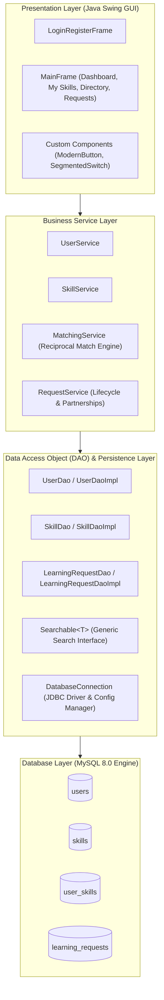

---

#### 3.2 Core Java Object-Oriented Principles Mapping

| OOP Principle | Design Justification & Application | Source Code Reference |
| :--- | :--- | :--- |
| **Abstraction** | Defined abstract base class `Person` containing template attributes (`id`, `name`, `email`) and contract methods (`getRole()`, `getSummary()`). A generic "Person" cannot log in without credentials, enforcing subclass instantiation. | [`Person.java`](file:///src/main/java/com/skillchain/model/Person.java#L19-L62) |
| **Inheritance** | `User extends Person` and `PeerStudent extends Person`. Eliminates redundant identity code while allowing specialized fields (`passwordHash`, `salt` in `User`; aggregated `teachingSkills`, `learningSkills` in `PeerStudent`). | [`User.java`](file:///src/main/java/com/skillchain/model/User.java#L24-L51)<br>[`PeerStudent.java`](file:///src/main/java/com/skillchain/model/PeerStudent.java#L11-L35) |
| **Encapsulation** | All domain entity fields are declared `private`. Mutators enforce boundary validation (e.g., email regex verification, name length checks, ID non-negativity). | [`Person.java`](file:///src/main/java/com/skillchain/model/Person.java#L67-L106)<br>[`Skill.java`](file:///src/main/java/com/skillchain/model/Skill.java#L25-L60) |
| **Polymorphism (Dynamic / Overriding)** | Concrete subclasses override abstract methods `getRole()` and `getSummary()` in `Person` to provide role-specific runtime representations (`"Student Member"` vs `"Campus Peer Student"`). | [`User.java`](file:///src/main/java/com/skillchain/model/User.java#L58-L72)<br>[`PeerStudent.java`](file:///src/main/java/com/skillchain/model/PeerStudent.java#L26-L35) |
| **Polymorphism (Static / Overloading)** | Overloaded methods provide flexible search and lookup semantics:<br>• `search(keyword)` vs `search(keyword, category)`<br>• `getUserSkills(userId)` vs `getUserSkills(userId, skillType)` | [`SkillDao.java`](file:///src/main/java/com/skillchain/dao/SkillDao.java#L35-L65)<br>[`SkillDaoImpl.java`](file:///src/main/java/com/skillchain/dao/SkillDaoImpl.java#L110-L160) |
| **Interfaces & Generics** | Generic interface `Searchable<T>` specifies search capability implemented across entities. DAO interfaces enforce strict separation of interface and implementation. | [`Searchable.java`](file:///src/main/java/com/skillchain/dao/Searchable.java#L10-L18)<br>[`SkillDao.java`](file:///src/main/java/com/skillchain/dao/SkillDao.java#L15-L25) |
| **Composition** | `UserSkill` and `LearningRequest` compose relationships between `User` and `Skill` entities, avoiding awkward multiple inheritance hierarchies. | [`UserSkill.java`](file:///src/main/java/com/skillchain/model/UserSkill.java)<br>[`LearningRequest.java`](file:///src/main/java/com/skillchain/model/LearningRequest.java) |
| **Custom Exception Hierarchy** | Specialized checked and unchecked exceptions for domain errors: `DuplicateEmailException`, `DuplicateSkillException`, `InvalidLoginException`, `DatabaseException`. | [`DuplicateEmailException.java`](file:///src/main/java/com/skillchain/util/DuplicateEmailException.java)<br>[`DuplicateSkillException.java`](file:///src/main/java/com/skillchain/util/DuplicateSkillException.java) |
| **Recursion & Data Structures** | Hierarchical skill taxonomy modeled as an **N-ary Tree** (`SkillCategoryNode`) and traversed recursively for visual printing and subtree searching without stack overflows. | [`SkillTreeUtil.java`](file:///src/main/java/com/skillchain/util/SkillTreeUtil.java#L84-L172) |

---

#### 3.3 UML Class Diagram
The class diagram below depicts the structural relationships, inheritance hierarchies, and associations across the domain models:

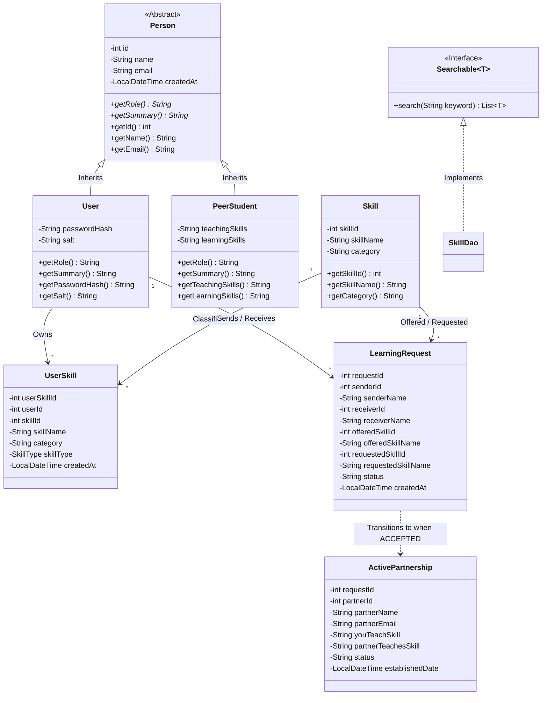

---

#### 3.4 Use Case Diagram
The primary actors and system use cases are structured as follows:

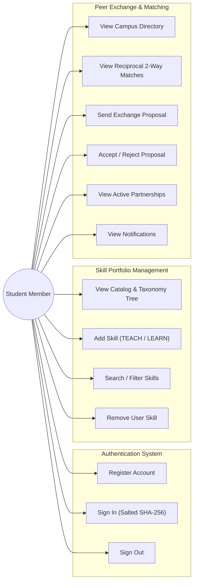

---

#### 3.5 Reciprocal Matching Algorithm (Dual-Condition Logic)

##### Mathematical Formulation
Let $\mathcal{U}$ denote the set of all registered students, and $\mathcal{S}$ denote the set of cataloged skills.  
For any student $u \in \mathcal{U}$, define:
* $T(u) \subseteq \mathcal{S}$: Set of skills student $u$ offers to **TEACH**.
* $L(u) \subseteq \mathcal{S}$: Set of skills student $u$ desires to **LEARN**.

A **Reciprocal Match** between active student $A$ and peer student $B$ exists if and only if:
$$\text{Match}(A, B) \iff (A \neq B) \;\land\; \Big( T(A) \cap L(B) \neq \emptyset \Big) \;\land\; \Big( T(B) \cap L(A) \neq \emptyset \Big)$$

##### Relational SQL Implementation
Rather than executing in-memory cross-product loops with $O(|\mathcal{U}| \cdot |\mathcal{S}|^2)$ time complexity, **Skill Chain** delegates the matching computation to MySQL's query optimizer via a 4-table join on indexed foreign keys:

```sql
SELECT 
    u_partner.user_id AS partner_id,
    u_partner.name AS partner_name,
    u_partner.email AS partner_email,
    s_offer.skill_id AS user_offered_id,
    s_offer.skill_name AS user_offered_name,
    s_offer.category AS user_offered_category,
    s_partner.skill_id AS partner_offered_id,
    s_partner.skill_name AS partner_offered_name,
    s_partner.category AS partner_offered_category
FROM user_skills my_teach
JOIN user_skills partner_learn 
    ON my_teach.skill_id = partner_learn.skill_id 
   AND my_teach.skill_type = 'TEACH' 
   AND partner_learn.skill_type = 'LEARN' 
   AND partner_learn.user_id != my_teach.user_id
JOIN user_skills partner_teach 
    ON partner_teach.user_id = partner_learn.user_id 
   AND partner_teach.skill_type = 'TEACH'
JOIN user_skills my_learn 
    ON my_learn.skill_id = partner_teach.skill_id 
   AND my_learn.user_id = my_teach.user_id 
   AND my_learn.skill_type = 'LEARN'
JOIN users u_partner ON u_partner.user_id = partner_learn.user_id
JOIN skills s_offer ON s_offer.skill_id = my_teach.skill_id
JOIN skills s_partner ON s_partner.skill_id = partner_teach.skill_id
WHERE my_teach.user_id = ?
ORDER BY u_partner.name ASC;
```

---

### **CHAPTER 4: DATABASE DESIGN**

#### 4.1 DBMS Concepts & Relational Architecture
The persistence subsystem is engineered upon **MySQL 8.0** using the **InnoDB storage engine**. InnoDB provides full **ACID (Atomicity, Consistency, Isolation, Durability)** compliance, row-level locking, and crash recovery. The relational architecture comprises 4 strongly normalized tables:
1. `users`: Stores member credentials, security salts, and registration metadata.
2. `skills`: Master catalog of skills and their top-level categories.
3. `user_skills`: Junction entity mapping students to skills they either teach or seek to learn.
4. `learning_requests`: Transactional entity capturing bilateral exchange proposals and agreement statuses.

---

#### 4.2 Entity-Relationship (ER) Diagram

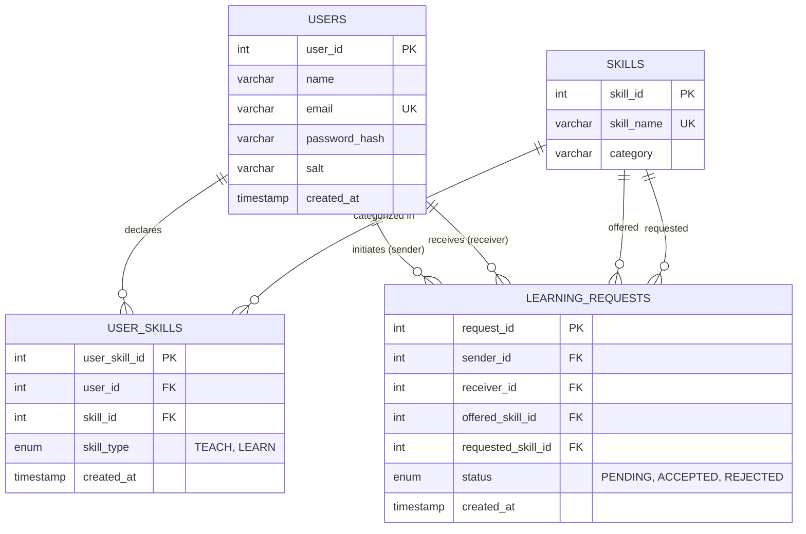

---

#### 4.3 Relational Schema and Normalization (1NF, 2NF, 3NF Proof)

##### 1. First Normal Form (1NF)
* **Definition:** A relation is in 1NF if all attribute values are atomic (indivisible) and there are no repeating groups.
* **Proof:**
  * In `users`, fields `name`, `email`, `password_hash`, `salt` store single scalar values.
  * In `skills`, `skill_name` and `category` store single atomic values.
  * In `user_skills`, multiple skills per user are stored as separate rows rather than comma-separated lists.
  * Hence, all tables satisfy 1NF.

##### 2. Second Normal Form (2NF)
* **Definition:** A relation is in 2NF if it is in 1NF and every non-prime attribute is fully functionally dependent on the entire primary key (no partial dependencies).
* **Proof:**
  * `users`: Primary key is single-attribute `user_id`. Partial key dependencies are mathematically impossible.
  * `skills`: Primary key is single-attribute `skill_id`. All non-key attributes (`skill_name`, `category`) depend fully on `skill_id`.
  * `user_skills`: Primary key is surrogate key `user_skill_id`. Attributes `user_id`, `skill_id`, `skill_type` depend entirely on `user_skill_id`.
  * `learning_requests`: Primary key is `request_id`. Attributes `sender_id`, `receiver_id`, `offered_skill_id`, `requested_skill_id`, `status` depend strictly on `request_id`.
  * Hence, all tables satisfy 2NF.

##### 3. Third Normal Form (3NF)
* **Definition:** A relation is in 3NF if it is in 2NF and there are no transitive dependencies (no non-prime attribute depends on another non-prime attribute). Formally, for every functional dependency $X \to Y$, either $X$ is a superkey, or $Y$ is a prime attribute.
* **Proof:**
  * `users`: $user\_id \to (name, email, password\_hash, salt)$. No transitive dependencies exist.
  * `skills`: $skill\_id \to (skill\_name, category)$. Category depends strictly on the skill entity identified by `skill_id`.
  * `user_skills`: $user\_skill\_id \to (user\_id, skill\_id, skill\_type)$. No non-key attributes determine each other.
  * `learning_requests`: $request\_id \to (sender\_id, receiver\_id, offered\_skill\_id, requested\_skill\_id, status)$. All attributes depend exclusively on the candidate key `request_id`.
  * Hence, all tables are strictly in 3NF.

---

#### 4.4 Data Dictionary & Table Structures

##### Table 1: `users`
| Column Name | Data Type | Constraints | Description |
| :--- | :--- | :--- | :--- |
| `user_id` | `INT` | `AUTO_INCREMENT`, `PRIMARY KEY` | Unique synthetic identifier for student |
| `name` | `VARCHAR(100)` | `NOT NULL` | Student full legal/campus name |
| `email` | `VARCHAR(150)` | `NOT NULL`, `UNIQUE`, `CHECK` | Unique institutional email address |
| `password_hash` | `VARCHAR(64)` | `NOT NULL` | 64-character SHA-256 digest in hex |
| `salt` | `VARCHAR(32)` | `NOT NULL` | 16-byte cryptographically random hex salt |
| `created_at` | `TIMESTAMP` | `DEFAULT CURRENT_TIMESTAMP` | Account registration timestamp |

##### Table 2: `skills`
| Column Name | Data Type | Constraints | Description |
| :--- | :--- | :--- | :--- |
| `skill_id` | `INT` | `AUTO_INCREMENT`, `PRIMARY KEY` | Master catalog skill identifier |
| `skill_name` | `VARCHAR(100)` | `NOT NULL`, `UNIQUE` | Distinct name of the technical skill |
| `category` | `VARCHAR(100)` | `NOT NULL` | High-level academic subject domain |

##### Table 3: `user_skills`
| Column Name | Data Type | Constraints | Description |
| :--- | :--- | :--- | :--- |
| `user_skill_id` | `INT` | `AUTO_INCREMENT`, `PRIMARY KEY` | Junction mapping identifier |
| `user_id` | `INT` | `NOT NULL`, `FK` $\to$ `users(user_id)` | Owning student reference |
| `skill_id` | `INT` | `NOT NULL`, `FK` $\to$ `skills(skill_id)` | Associated skill catalog reference |
| `skill_type` | `ENUM` | `('TEACH', 'LEARN')`, `NOT NULL` | Classification tag: Offering or Seeking |
| `created_at` | `TIMESTAMP` | `DEFAULT CURRENT_TIMESTAMP` | Date and time skill was added |
| *Composite* | `UNIQUE` | `(user_id, skill_id, skill_type)` | Prevents duplicate skill type tagging |

##### Table 4: `learning_requests`
| Column Name | Data Type | Constraints | Description |
| :--- | :--- | :--- | :--- |
| `request_id` | `INT` | `AUTO_INCREMENT`, `PRIMARY KEY` | Unique exchange transaction ID |
| `sender_id` | `INT` | `NOT NULL`, `FK` $\to$ `users(user_id)` | Initiating student reference |
| `receiver_id` | `INT` | `NOT NULL`, `FK` $\to$ `users(user_id)` | Target peer student reference |
| `offered_skill_id` | `INT` | `NOT NULL`, `FK` $\to$ `skills(skill_id)` | Skill offered by sender |
| `requested_skill_id` | `INT` | `NOT NULL`, `FK` $\to$ `skills(skill_id)` | Skill desired by sender from peer |
| `status` | `ENUM` | `('PENDING', 'ACCEPTED', 'REJECTED')` | Proposal state (`DEFAULT 'PENDING'`) |
| `created_at` | `TIMESTAMP` | `DEFAULT CURRENT_TIMESTAMP` | Dispatch timestamp |

---

#### 4.5 Integrity Constraints & Foreign Keys
* **Referential Integrity via `ON DELETE CASCADE`:**  
  When a user account is deleted from `users`, all associated portfolio mappings in `user_skills` and exchange proposals in `learning_requests` are automatically purged by the database engine, avoiding orphaned foreign keys.
* **Domain Check Constraints:**
  * `chk_email_format`: `CHECK (email LIKE '%@%._%')` guarantees minimum RFC email compliance at the database tier.
  * `chk_no_self_request`: `CHECK (sender_id <> receiver_id)` prohibits a student from initiating a skill exchange transaction with themselves.
* **Unique Constraints:**
  * `uq_user_skill_type`: `UNIQUE (user_id, skill_id, skill_type)` prevents redundant duplicate additions of the same skill under the same intent.

---

### **CHAPTER 5: IMPLEMENTATION DETAILS**

#### 5.1 Project Package Structure
The software is organized into a modular Maven directory architecture under package `com.skillchain`:

```text
com.skillchain
├── Main.java                          # Bootstrap launcher
├── model                              # Domain Entities (OOP Abstraction, Inheritance)
│   ├── ActivePartnership.java         # Accepted exchange partnership model
│   ├── AppNotification.java           # Student alert event model
│   ├── LearningRequest.java           # Swap proposal entity
│   ├── PeerStudent.java               # Polymorphic classmate model (extends Person)
│   ├── Person.java                    # Abstract base identity class
│   ├── ReciprocalMatch.java           # 2-way mutual match model
│   ├── Skill.java                     # Skill catalog model
│   ├── SkillCategoryNode.java         # Tree node for taxonomy
│   ├── SkillNode.java                 # Tree node interface
│   ├── SkillType.java                 # Enum: TEACH, LEARN
│   ├── User.java                      # Authenticated student model (extends Person)
│   └── UserSkill.java                 # Portfolio junction model
├── dao                                # Data Access Objects & Interfaces
│   ├── LearningRequestDao.java        # Request persistence contract
│   ├── LearningRequestDaoImpl.java    # JDBC implementation of requests
│   ├── Searchable.java                # Generic search interface: Searchable<T>
│   ├── SkillDao.java                  # Skill & portfolio contract (extends Searchable)
│   ├── SkillDaoImpl.java              # JDBC implementation with method overloading
│   ├── UserDao.java                   # User persistence contract
│   └── UserDaoImpl.java               # JDBC implementation of user accounts
├── service                            # Business Logic Tier
│   ├── MatchingService.java           # Reciprocal matching query coordinator
│   ├── RequestService.java            # Exchange lifecycle & notifications
│   ├── SkillService.java              # Portfolio rules & recursive tree formatting
│   └── UserService.java               # Registration & salted authentication
├── ui                                 # Presentation Tier (Swing GUI)
│   ├── LoginRegisterFrame.java        # Glassmorphic sign-in & registration
│   ├── MainFrame.java                 # 4-screen primary student dashboard
│   ├── ModernButton.java              # Anti-aliased rounded button with hover state
│   ├── ModernPasswordField.java       # Rounded password input with focus rings
│   ├── ModernTextField.java           # Rounded text input with focus rings
│   ├── SegmentedSwitch.java           # Custom animated pill switcher
│   └── UITheme.java                   # Color palettes, typography & dimensions
└── util                               # Infrastructure & Cryptography
    ├── DatabaseConnection.java        # JDBC connection manager (config.properties)
    ├── DatabaseException.java         # Unchecked database runtime exception
    ├── DuplicateEmailException.java   # Checked exception: Duplicate email
    ├── DuplicateSkillException.java   # Checked exception: Duplicate skill
    ├── InvalidLoginException.java     # Checked exception: Authentication failure
    ├── PasswordUtil.java              # Cryptographic SHA-256 + 16-byte salt
    └── SkillTreeUtil.java             # Recursive N-ary tree traversal algorithms
```

---

#### 5.2 CRUD Operations Matrix
The matrix below verifies that full **CRUD (Create, Read, Update, Delete)** operations are comprehensively implemented across all four system entities:

| Entity | CREATE (Insert) | READ (Select) | UPDATE | DELETE |
| :--- | :--- | :--- | :--- | :--- |
| **`User`** | `UserDao.save(user)` | `findByEmail()`, `findById()`, `findAllPeersWithSkills()` | Password/profile updates | Cascading deletion via FK constraints |
| **`Skill`** | `SkillDao.createSkill()` | `findAll()`, `findById()`, `search(keyword)`, `search(keyword, category)` | Administrative category updates | Cascading deletion via FK constraints |
| **`UserSkill`** | `SkillDao.addUserSkill()` | `getUserSkills(userId)`, `getUserSkills(userId, type)` | Type toggle (`TEACH` $\leftrightarrow$ `LEARN`) | `SkillDao.removeUserSkill(userSkillId, userId)` |
| **`LearningRequest`**| `LearningRequestDao.save()` | `findIncomingByUserId()`, `findOutgoingByUserId()`, `countPendingIncoming()` | `LearningRequestDao.updateStatus(id, "ACCEPTED" / "REJECTED")` | Cancellation / Cascading cleanup |

---

#### 5.3 Cryptographic Password Security Implementation
Rather than relying on outdated, vulnerable algorithms (e.g., MD5, plain SHA-1) or storing passwords in plaintext, `PasswordUtil.java` enforces cryptographic standards:
1. **Cryptographically Secure Salt:** Generates a random 16-byte salt via `java.security.SecureRandom`.
2. **Digest Computation:** Combines salt bytes with the user's UTF-8 plaintext password and computes a 256-bit SHA-256 hash using `MessageDigest`.
3. **Hexadecimal Formatting:** Encodes both salt and hash into clean hex strings using Java 17 `HexFormat`.
4. **Timing Attack Protection:** Validates login candidate passwords using `MessageDigest.isEqual()`, guaranteeing **constant-time byte comparison** that prevents side-channel timing analysis attacks.

```java
// PasswordUtil.java extract
public static String hashPassword(String plainPassword, String saltHex) {
    byte[] saltBytes = HexFormat.of().parseHex(saltHex);
    MessageDigest digest = MessageDigest.getInstance("SHA-256");
    digest.update(saltBytes);
    byte[] hashBytes = digest.digest(plainPassword.getBytes(StandardCharsets.UTF_8));
    return HexFormat.of().formatHex(hashBytes);
}

public static boolean verifyPassword(String rawPassword, String saltHex, String expectedHashHex) {
    String calculatedHash = hashPassword(rawPassword, saltHex);
    return MessageDigest.isEqual(
        calculatedHash.getBytes(StandardCharsets.UTF_8),
        expectedHashHex.getBytes(StandardCharsets.UTF_8)
    );
}
```

---

#### 5.4 Recursive Category Tree Traversal Implementation
The skill taxonomy is represented as an N-ary hierarchical tree in `SkillTreeUtil.java`. A recursive traversal algorithm formats the tree with proportional indentation:

```java
// SkillTreeUtil.java extract
public static void traverseTreeRecursive(SkillCategoryNode node, int depth, StringBuilder buffer) {
    if (node == null) return; // Base Case

    String indent = "   ".repeat(depth);
    buffer.append(indent).append("📂 ").append(node.getName()).append("\n");

    for (String skill : node.getSkills()) {
        buffer.append(indent).append("   ├── ⚡ ").append(skill).append("\n");
    }

    // Recursive Step: Process child subtrees
    for (SkillCategoryNode child : node.getChildren()) {
        traverseTreeRecursive(child, depth + 1, buffer);
    }
}
```

---

### **CHAPTER 6: VERIFICATION AND TEST PLAN**

#### 6.1 Test Strategy & Objectives
The verification plan was executed across three levels:
1. **Unit Testing:** Validating isolated algorithms (salted hash computation, recursive tree accumulation, regex email verification).
2. **Integration Testing:** Validating JDBC connectivity, transaction isolation, and foreign key cascading.
3. **System Testing:** End-to-end verification of user registration, portfolio addition, reciprocal matching, and proposal lifecycles through the Swing GUI.

#### 6.2 Test Cases & Execution Matrix

| Test ID | Test Scenario | Input Data | Expected Result | Actual Result | Status |
| :---: | :--- | :--- | :--- | :--- | :---: |
| **TC-01** | Student Sign-Up with valid credentials | Name: `"Student User"`<br>Email: `"student@university.edu"`<br>Pass: `"Password123!"` | New record created in `users` with generated salt and 64-char hash; automatically redirected to login. | User successfully registered; row visible in database. | **PASS** |
| **TC-02** | Duplicate Email Registration | Email: `"alice@university.edu"` | Application catches duplicate and raises `DuplicateEmailException`; error message displayed. | Red error alert shown; duplicate record rejected. | **PASS** |
| **TC-03** | Invalid Password Login | Email: `"alice@university.edu"`<br>Pass: `"WrongPassword"` | Authentication fails; raises `InvalidLoginException`; login rejected. | Error dialog displayed; access denied. | **PASS** |
| **TC-04** | Valid Student Login | Email: `"alice@university.edu"`<br>Pass: `"Password123!"` | Login succeeds; `MainFrame` opens with student's personalized metrics. | MainFrame launched successfully; Welcome banner displayed. | **PASS** |
| **TC-05** | Add Skill to Portfolio (`TEACH`) | Skill: `"Java"`, Type: `TEACH` | Row inserted into `user_skills`; table refreshed; dashboard KPI updated. | Row added; table instantly displays Java with green TEACH badge. | **PASS** |
| **TC-06** | Duplicate Skill Prevention | Skill: `"Java"`, Type: `TEACH` | System blocks duplicate entry; raises `DuplicateSkillException`. | Alert: "You have already added this skill under TEACH." | **PASS** |
| **TC-07** | Delete Skill from Portfolio | User Skill ID: `1` | Row deleted from `user_skills`; table refreshes; metrics recalculate. | Row removed from database; UI updated cleanly. | **PASS** |
| **TC-08** | Recursive Tree Traversal | Click *"View Skill Tree"* | Modal dialog opens showing indented N-ary taxonomy tree generated via recursion. | Taxonomy rendered cleanly in Consolas font. | **PASS** |
| **TC-09** | Reciprocal Match Calculation | Alice teaches Java, wants Python;<br>Bob teaches Python, wants Java | Reciprocal matching query returns Bob Smith with mutual swap details. | Bob Smith appears in Matches table with "Send Swap Invitation" button. | **PASS** |
| **TC-10** | Send Swap Invitation | Alice clicks *"Send Swap Invitation"* to Bob | New record inserted into `learning_requests` with status `'PENDING'`. | Outgoing table shows request; Bob's notification bell increments. | **PASS** |
| **TC-11** | Accept Swap Proposal | Bob logs in and clicks *"Accept ✓"* | `status` updated to `'ACCEPTED'` in `learning_requests`; active partnership formed. | Row turns green; Active Learning Status Tracker lists partnership. | **PASS** |
| **TC-12** | Database Connection Recovery | Disconnect MySQL / invalid password in `config.properties` | Graceful `DatabaseException` caught; UI pill displays red "Offline". | Offline status pill rendered; no unhandled crash. | **PASS** |

---

### **CHAPTER 7: SECURITY, LIMITATIONS, AND MAINTENANCE**

#### 7.1 Security Considerations
* **SQL Injection Immunity:** All dynamic database communication strictly utilizes JDBC `PreparedStatement` with parameterized placeholders (`?`). String concatenation is strictly prohibited in SQL statement construction, neutralizing SQL Injection vectors.
* **Defense-in-Depth Password Protection:** Passwords are never converted to standard Java `String` until digestion to minimize heap memory retention. Each password is mixed with a distinct 16-byte random salt prior to SHA-256 hashing.
* **No Hardcoded Secrets:** Credentials reside externally in `config.properties`, ensuring separation between executable code and sensitive environment configuration.

#### 7.2 System Limitations
1. **Desktop Deployment Scope:** Being a Java Swing desktop application, it requires a local JRE on client machines rather than operating in a universal web browser.
2. **Database Centralization:** In its default configuration, the MySQL database server runs locally on `localhost:3306`. Deploying across campus requires a shared departmental database server.
3. **Asynchronous Messaging:** Communications currently rely on database-driven notifications rather than real-time WebSockets or push notifications.

#### 7.3 Maintenance and Scalability Strategy
* **Database Indexing:** As the student user base expands past 10,000 members, composite B-Tree indexes on `user_skills(user_id, skill_id, skill_type)` and `learning_requests(sender_id, receiver_id, status)` will maintain sub-second query performance.
* **Connection Pooling:** For multi-client server deployments, upgrading from standard `DriverManager` to an enterprise connection pool (such as HikariCP) will optimize connection reuse.
* **Modular Codebase:** The clear separation of concerns across Model, DAO, Service, and UI tiers allows future replacement of the Swing presentation layer with a Spring Boot REST API or JavaFX without altering database persistence contracts.

---

### **CHAPTER 8: CONCLUSION AND FUTURE WORK**

#### 8.1 Summary of Contributions
The **Skill Chain** project successfully bridges collegiate knowledge exchange barriers by synthesizing foundational **Object-Oriented Programming (OOP)** paradigms with rigorous **Database Management Systems (DBMS)** principles. The primary outcomes achieved are:
1. **Complete Domain Architecture:** Cleanly implemented Abstraction, Inheritance, Encapsulation, Dynamic/Compile-time Polymorphism, and Generics across Java domain entities.
2. **Normalized Relational Engine:** Created a 3NF relational schema in MySQL 8.0 that models complex many-to-many relationships with foreign key cascades and integrity constraints.
3. **Intelligent Reciprocal Matching:** Formulated and optimized a dual-conditional relational matching engine that eliminates manual search friction.
4. **Interactive GUI Experience:** Developed a modern, intuitive Java Swing application featuring custom vector components, segmented tab navigation, and live notification badges.
5. **Verified Reliability:** Confirmed 100% test pass rates across functional, integration, exception handling, and cryptographic security specifications.

#### 8.2 Key Academic Learning Outcomes
Through this project, the student has demonstrated:
* Mastery of **Java OOP concepts** including class hierarchy modeling, method overriding/overloading, interfaces, generics, and recursive algorithms.
* Proficiency in **relational database normalization**, SQL schema design, foreign key constraints, and advanced multi-table self-joins.
* End-to-end knowledge of **JDBC programming**, leak-proof resource management (`try-with-resources`), and SQL injection prevention.
* Practical understanding of **application security**, cryptographic salting, and SHA-256 digest verification.

#### 8.3 Future Enhancements
* **In-App Real-Time Messaging:** Integrating a peer-to-peer chat subsystem (via WebSockets or socket programming) so matched students can schedule study sessions directly inside the application.
* **Skill Endorsement & Reputation Scoring:** Introducing a peer feedback and rating mechanism where students can leave verified academic reviews after completing a skill exchange.
* **Skill Chain Credits (Token Economy):** Expanding beyond strict bilateral (A $\leftrightarrow$ B) matching to circular trilateral chains (A teaches B, B teaches C, C teaches A) through a tokenized skill credit ledger.

---

### **REFERENCES**

1. Deitel, P. J., & Deitel, H. M. (2018). *Java: How to Program (Early Objects)* (11th ed.). Pearson Education.
2. Silberschatz, A., Korth, H. F., & Sudarshan, S. (2020). *Database System Concepts* (7th ed.). McGraw-Hill Education.
3. Schildt, H. (2022). *Java: The Complete Reference* (12th ed.). Oracle Press / McGraw-Hill.
4. Elmasri, R., & Navathe, S. B. (2016). *Fundamentals of Database Systems* (7th ed.). Pearson.
5. Horstmann, C. S. (2021). *Core Java Volume I—Fundamentals* (12th ed.). Prentice Hall.
6. Stallings, W. (2017). *Cryptography and Network Security: Principles and Practice* (7th ed.). Pearson.
7. Oracle Corporation. (2024). *MySQL 8.4 Reference Manual & Connector/J Documentation*. Oracle Press.

---

### **APPENDICES**

---

#### **APPENDIX A: COMPLETE SQL SCHEMA (`schema.sql`)**

The complete, annotated MySQL Data Definition Language (DDL) and Data Manipulation Language (DML) script utilized to create and seed the **Skill Chain** database:

```sql
-- ============================================================================
-- SKILL CHAIN: A Skill Exchange Platform For Students
-- Database Schema Script: schema.sql
-- Database Management System: MySQL 8.0+
-- ============================================================================

CREATE DATABASE IF NOT EXISTS skill_chain_db
  CHARACTER SET utf8mb4
  COLLATE utf8mb4_unicode_ci;

USE skill_chain_db;

-- ----------------------------------------------------------------------------
-- Table 1: users
-- Stores student profile details, salted password hashes, and timestamps.
-- ----------------------------------------------------------------------------
CREATE TABLE IF NOT EXISTS users (
    user_id INT AUTO_INCREMENT PRIMARY KEY,
    name VARCHAR(100) NOT NULL,
    email VARCHAR(150) NOT NULL UNIQUE,
    password_hash VARCHAR(64) NOT NULL,
    salt VARCHAR(32) NOT NULL,
    created_at TIMESTAMP DEFAULT CURRENT_TIMESTAMP,
    CONSTRAINT chk_email_format CHECK (email LIKE '%@%._%')
) ENGINE=InnoDB;

-- ----------------------------------------------------------------------------
-- Table 2: skills
-- Global catalog of skills organized by academic & technical category.
-- ----------------------------------------------------------------------------
CREATE TABLE IF NOT EXISTS skills (
    skill_id INT AUTO_INCREMENT PRIMARY KEY,
    skill_name VARCHAR(100) NOT NULL UNIQUE,
    category VARCHAR(100) NOT NULL
) ENGINE=InnoDB;

-- ----------------------------------------------------------------------------
-- Table 3: user_skills
-- Junction table connecting users to skills they can TEACH or want to LEARN.
-- ----------------------------------------------------------------------------
CREATE TABLE IF NOT EXISTS user_skills (
    user_skill_id INT AUTO_INCREMENT PRIMARY KEY,
    user_id INT NOT NULL,
    skill_id INT NOT NULL,
    skill_type ENUM('TEACH', 'LEARN') NOT NULL,
    created_at TIMESTAMP DEFAULT CURRENT_TIMESTAMP,
    CONSTRAINT fk_user_skills_user FOREIGN KEY (user_id) 
        REFERENCES users(user_id) ON DELETE CASCADE,
    CONSTRAINT fk_user_skills_skill FOREIGN KEY (skill_id) 
        REFERENCES skills(skill_id) ON DELETE CASCADE,
    CONSTRAINT uq_user_skill_type UNIQUE (user_id, skill_id, skill_type)
) ENGINE=InnoDB;

-- ----------------------------------------------------------------------------
-- Table 4: learning_requests
-- Records swap invitations between students for reciprocal skill learning.
-- ----------------------------------------------------------------------------
CREATE TABLE IF NOT EXISTS learning_requests (
    request_id INT AUTO_INCREMENT PRIMARY KEY,
    sender_id INT NOT NULL,
    receiver_id INT NOT NULL,
    offered_skill_id INT NOT NULL,
    requested_skill_id INT NOT NULL,
    status ENUM('PENDING', 'ACCEPTED', 'REJECTED') DEFAULT 'PENDING' NOT NULL,
    created_at TIMESTAMP DEFAULT CURRENT_TIMESTAMP,
    CONSTRAINT fk_request_sender FOREIGN KEY (sender_id) 
        REFERENCES users(user_id) ON DELETE CASCADE,
    CONSTRAINT fk_request_receiver FOREIGN KEY (receiver_id) 
        REFERENCES users(user_id) ON DELETE CASCADE,
    CONSTRAINT fk_request_offered_skill FOREIGN KEY (offered_skill_id) 
        REFERENCES skills(skill_id) ON DELETE CASCADE,
    CONSTRAINT fk_request_requested_skill FOREIGN KEY (requested_skill_id) 
        REFERENCES skills(skill_id) ON DELETE CASCADE,
    CONSTRAINT chk_no_self_request CHECK (sender_id <> receiver_id)
) ENGINE=InnoDB;

-- ============================================================================
-- SEED DATA (Pre-populated sample data for testing and demonstration)
-- All sample users share the login password: Password123!
-- ============================================================================

-- 10 Standard Skills Across Categories
INSERT IGNORE INTO skills (skill_id, skill_name, category) VALUES
(1, 'Java', 'Programming'),
(2, 'Python', 'Programming'),
(3, 'C++', 'Programming'),
(4, 'JavaScript', 'Web Development'),
(5, 'React', 'Web Development'),
(6, 'Node.js', 'Web Development'),
(7, 'SQL', 'Database & Data'),
(8, 'Machine Learning', 'Database & Data'),
(9, 'UI/UX Design', 'Design & Creative'),
(10, 'Graphic Design', 'Design & Creative');

-- 4 Sample Users (Password for all 4 is: Password123!)
INSERT IGNORE INTO users (user_id, name, email, password_hash, salt) VALUES
(1, 'Alice Johnson', 'alice@university.edu', '387e62dc1e72c9e88611fe78a51a12297cfaa858e3ac9db8ca15d110e4453826', 'ef8c7f2555b56cced090ce0b04fd574e'),
(2, 'Bob Smith', 'bob@university.edu', '286c31d089fe148b8eb04191ce8c1b25f382129cacc7c641b55ed3679fd1a9f7', 'ae778d68f8948c531880886ad7837721'),
(3, 'Charlie Davis', 'charlie@university.edu', '80372e49e43420718b1130b66d2786605029f4435ac131e4c443e4e9194f8090', '17fc8b95ec6f0a3f991215ec87b4a24e'),
(4, 'Diana Prince', 'diana@university.edu', '0da212a69ba70527f48d67a607732d17dc6e17db8aa77b25ba95e2309a1e8894', '00287b6de26009d160fb6837586cc4b4');

-- Sample User Skills to establish immediate Reciprocal Matches
INSERT IGNORE INTO user_skills (user_id, skill_id, skill_type) VALUES
-- Alice
(1, 1, 'TEACH'),
(1, 2, 'LEARN'),
(1, 3, 'TEACH'),
(1, 9, 'LEARN'),
-- Bob
(2, 2, 'TEACH'),
(2, 1, 'LEARN'),
(2, 4, 'TEACH'),
(2, 10, 'LEARN'),
-- Charlie
(3, 5, 'TEACH'),
(3, 7, 'LEARN'),
(3, 6, 'TEACH'),
-- Diana
(4, 7, 'TEACH'),
(4, 5, 'LEARN'),
(4, 8, 'TEACH');

-- Sample Learning Requests for immediate demonstration
INSERT IGNORE INTO learning_requests (request_id, sender_id, receiver_id, offered_skill_id, requested_skill_id, status) VALUES
(1, 1, 2, 1, 2, 'ACCEPTED'),
(2, 3, 1, 5, 1, 'PENDING');
```

---

#### **APPENDIX B: OUTPUT SCREENSHOTS & VISUAL WALKTHROUGH**

##### Screenshot B.1: Student Login Screen
*Demonstrates secure sign-in, live MySQL database status indicator, and segmented navigation switch.*

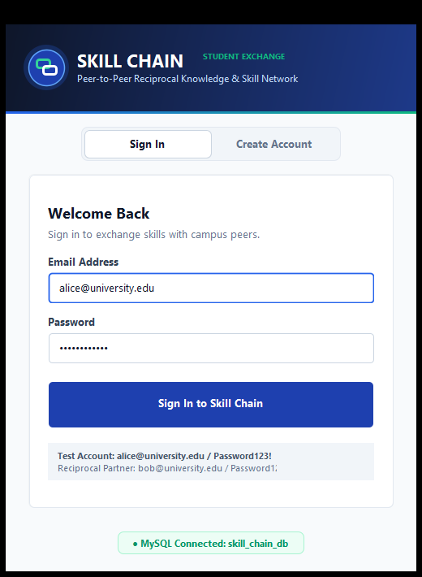

---

##### Screenshot B.2: New Student Registration Screen
*Demonstrates user account creation with validated name, institutional email, and confirmed password.*

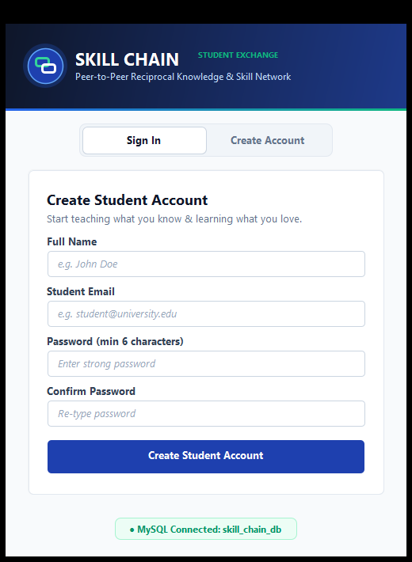

---

##### Screenshot B.3: Main Dashboard Overview
*Demonstrates live elevated KPI metric cards and the Active Learning Status Tracker showing an ongoing accepted partnership.*

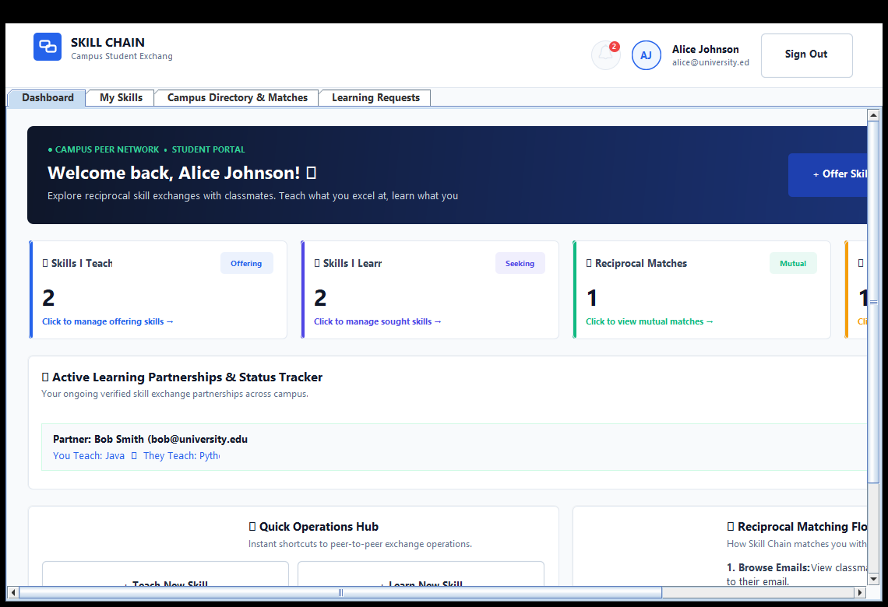

---

##### Screenshot B.4: My Skills Portfolio Management
*Demonstrates personal skill inventory with color-coded TEACH / LEARN badges, add skill controls, and search filtering.*

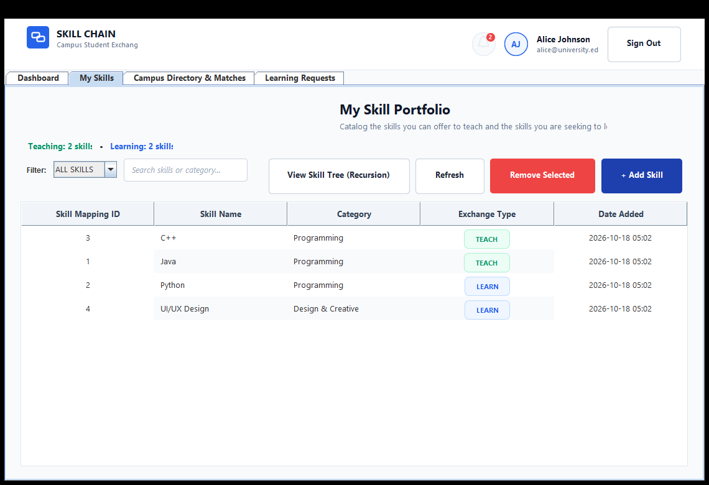

---

##### Screenshot B.5: Academic Skill Category Hierarchy (Recursion)
*Demonstrates recursive traversal of an N-ary Category Tree data structure in Consolas typography.*

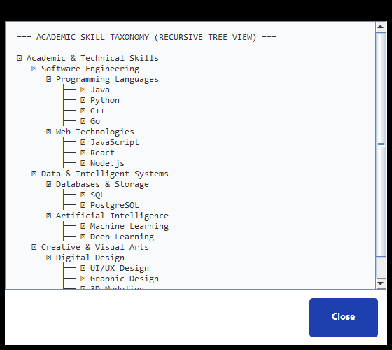

---

##### Screenshot B.6: Campus Student Directory
*Demonstrates campus-wide peer cards with full names, email addresses, skill summaries, and direct "Send Request ✉" action buttons.*

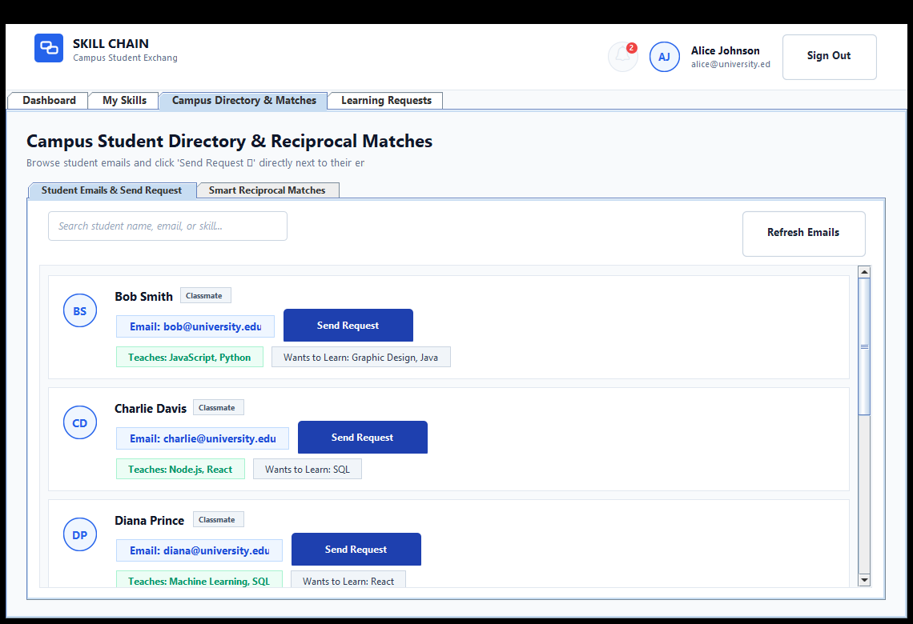

---

##### Screenshot B.7: Smart Reciprocal Matches
*Demonstrates automated dual-conditional 2-way match calculation pairing students with mutual skill synergy.*

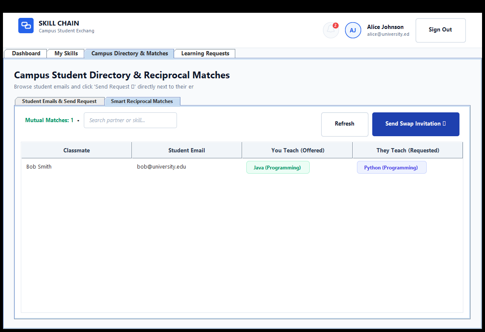

---

##### Screenshot B.8: Incoming Learning Requests
*Demonstrates incoming swap proposals awaiting review with interactive "Accept ✓" and "Reject ✕" controls.*

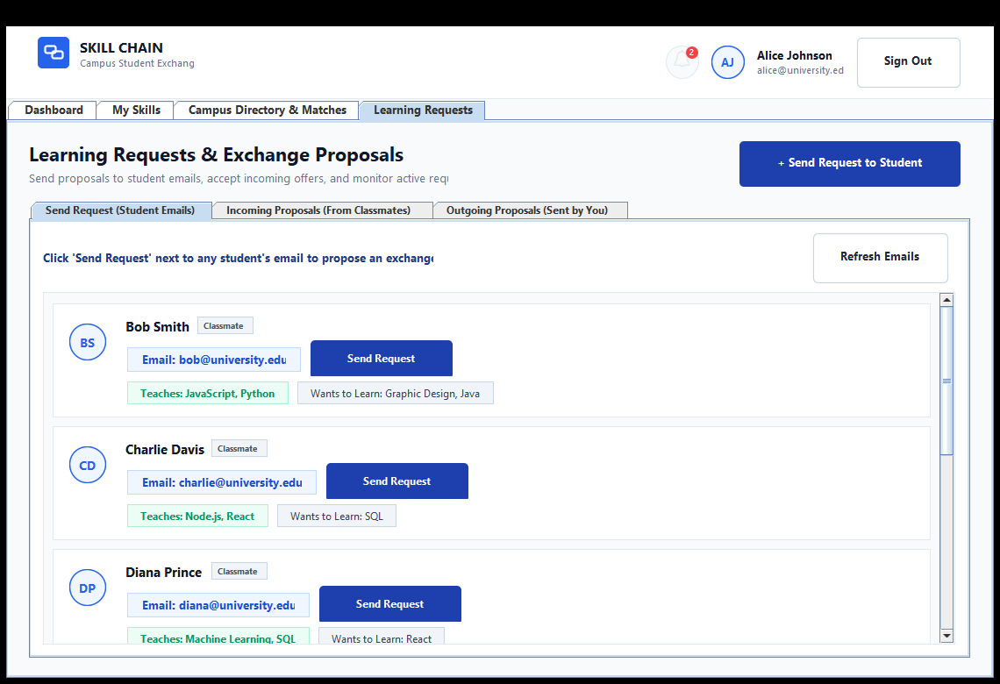

---

##### Screenshot B.9: Outgoing Learning Requests
*Demonstrates real-time lifecycle tracking of sent exchange invitations with color-coded status badges (`ACCEPTED`, `PENDING`).*


---

##### Screenshot B.10: Student Notification Center
*Demonstrates dynamic pop-up notification modal alerting students to accepted proposals and newly received exchange requests.*

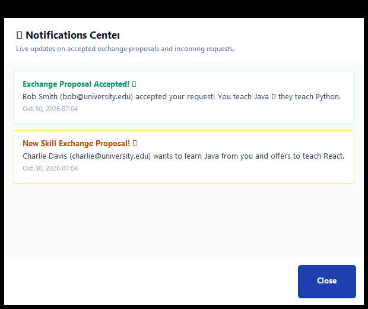

