# SKILL CHAIN: CAMPUS PEER-TO-PEER SKILL EXCHANGE PLATFORM
### Integrated OOPS and DBMS Project Report

**Submitted by**
* **VARSHA K – 250701807**
* **VANDHANA M – 250701804**
* **VARSHINI S – 250701809**
* **VARSSINI A – 250701811**

**of**  
**BACHELOR OF ENGINEERING**  
**in**  
**DEPARTMENT OF COMPUTER SCIENCE AND ENGINEERING**  

**RAJALAKSHMI ENGINEERING COLLEGE, THANDALAM**  
*(An Autonomous Institution)*  

<p align="center">
  
</p>

**November 2026**

---

## RAJALAKSHMI ENGINEERING COLLEGE
### BONAFIDE CERTIFICATE

Certified that this project report titled **“SKILL CHAIN: CAMPUS PEER-TO-PEER SKILL EXCHANGE PLATFORM”** is the bonafide work of **“VARSHA K (250701807), VANDHANA M (250701804), VARSHINI S (250701809), VARSSINI A (250701811)”** who carried out the project work under my supervision.

<br><br>

---------------------------------------------------- &emsp;&emsp;&emsp;&emsp;&emsp;&emsp;&emsp;&emsp; ----------------------------------------------------  
**SIGNATURE** &emsp;&emsp;&emsp;&emsp;&emsp;&emsp;&emsp;&emsp;&emsp;&emsp;&emsp;&emsp;&emsp;&emsp;&emsp;&emsp;&emsp;&emsp;&emsp;&emsp;&emsp; **SIGNATURE**  
Internal Faculty Name &emsp;&emsp;&emsp;&emsp;&emsp;&emsp;&emsp;&emsp;&emsp;&emsp;&emsp;&emsp;&emsp;&emsp;&emsp;&emsp; Internal Faculty Name  
Course Incharge &emsp;&emsp;&emsp;&emsp;&emsp;&emsp;&emsp;&emsp;&emsp;&emsp;&emsp;&emsp;&emsp;&emsp;&emsp;&emsp;&emsp;&emsp; Course Incharge  
Object Oriented Programming System &emsp;&emsp;&emsp;&emsp;&emsp;&emsp;&emsp;&emsp;&emsp; Database Management System  
Department of Computer Science and Engineering &emsp;&emsp;&emsp;&emsp; Department of Computer Science and Engineering  

<br><br>

---------------------------------------------------- &emsp;&emsp;&emsp;&emsp;&emsp;&emsp;&emsp;&emsp; ----------------------------------------------------  
**INTERNAL EXAMINER** &emsp;&emsp;&emsp;&emsp;&emsp;&emsp;&emsp;&emsp;&emsp;&emsp;&emsp;&emsp;&emsp;&emsp;&emsp;&emsp; **EXTERNAL EXAMINER**  

---

## ABSTRACT

In today's academic environment, peer learning and multidisciplinary skill development are essential for students seeking to expand beyond structured syllabi. **Skill Chain** is an application-based platform engineered to manage and facilitate bilateral student skill exchanges seamlessly without monetary transactions. Every university campus hosts a wide spectrum of distributed student proficiencies spanning programming languages, modern web frameworks, database administration, intelligent data systems, and creative digital arts.

This project delivers an intuitive, responsive desktop user interface developed using Java Swing and backed by the MySQL relational database management system. The system leverages robust database principles—including Third Normal Form (3NF) relational design, referential integrity cascades, and parameterized JDBC data access—to ensure strict data consistency and security. This platform eliminates manual, disorganized inquiries across social media forums, saving valuable student time, reducing administrative friction, and preventing duplicate data entries.

The primary objective of this integrated project is to register students, maintain personal skill portfolios (TEACH and LEARN designations), perform full CRUD operations, automatically identify complementary learning partners using a dual-conditional reciprocal matching algorithm, and manage the full lifecycle of exchange invitations (PENDING, ACCEPTED, REJECTED). The system was developed using foundational technologies: **MySQL Database** and **Core Java (JDK 17)** with **JDBC (Java Database Connectivity)**.

---

## TABLE OF CONTENTS

| CHAPTER | CONTENTS | PAGE NO. |
| :---: | :--- | :---: |
| **1** | **INTRODUCTION** | **5** |
| | • PROBLEM STATEMENT | 5 |
| | • PROJECT OVERVIEW | 5 |
| | • PURPOSE | 6 |
| | • SCOPE | 6 |
| **2** | **FUNCTIONALITIES PROVIDED** | **7** |
| **3** | **SYSTEM FLOW DIAGRAM** | **8** |
| | • DATAFLOW DIAGRAM (DFD) | 8 |
| | • USE CASE DIAGRAM | 9 |
| | • ENTITY RELATIONSHIP DIAGRAM (ERD) | 10 |
| **4** | **MODULE DESCRIPTION** | **11** |
| **5** | **IMPLEMENTATION** | **13** |
| | • 5.1 JDBC DATABASE CONNECTION | 13 |
| | • 5.2 MAIN CLASS LAUNCHER | 15 |
| | • 5.3 LOGIN & REGISTRATION MODULE | 17 |
| | • 5.4 STUDENT DASHBOARD & ACTIVE PARTNERSHIPS | 23 |
| | • 5.5 MY SKILLS PORTFOLIO (CRUD OPERATIONS) | 28 |
| | • 5.6 RECURSIVE CATEGORY TREE TAXONOMY | 35 |
| | • 5.7 CAMPUS STUDENT DIRECTORY & DIRECT PROPOSALS | 39 |
| | • 5.8 SMART RECIPROCAL MATCHING ENGINE | 43 |
| | • 5.9 LEARNING REQUESTS MANAGEMENT (ACCEPT / REJECT) | 47 |
| | • 5.10 STUDENT NOTIFICATION CENTER | 52 |
| **6** | **CONCLUSION** | **55** |
| **7** | **REFERENCES** | **56** |

---

## 1. INTRODUCTION

### PROBLEM STATEMENT
On university campuses, students frequently desire to acquire specialized technical and design skills outside their formal academic curriculum. While many classmates possess the exact skills desired, discovering compatible peers who are willing to exchange their knowledge in return for mutual learning is challenging. Informal word-of-mouth coordination is inefficient, fragmented across social media chats, lacks verification, and cannot compute multi-way compatibility. Therefore, an automated student skill exchange system is required to catalog skills, track learner requirements, discover reciprocal teaching-learning matches, and manage study proposals securely.

### PROJECT OVERVIEW
**Skill Chain: Campus Peer-to-Peer Skill Exchange Platform** is a comprehensive software solution designed to streamline, automate, and organize student skill collaboration within an institution. This project aims to develop a user-friendly and efficient desktop system that facilitates student authentication, skill portfolio management, automated bidirectional matchmaking, and request status tracking.

Skill Chain captures and securely stores student details including personal identity, institutional credentials, teaching proficiencies, and learning aspirations. Through an automated **Reciprocal Matching Engine**, the platform pairs students when:
$$\text{Student A teaches what Student B seeks} \quad \land \quad \text{Student B teaches what Student A seeks}$$
This project organizes student data systematically and ensures that academic peer exchange operates transparently without monetary expense.

### PURPOSE
* The system is aimed at delivering total user-friendliness as well as efficient management of academic peer exchanges.
* To centralize and organize student skill portfolios in a systematic manner and facilitate easy access to accurate, up-to-date peer data, eliminating manual search errors and ensuring data integrity.
* To automate the identification of reciprocal exchange partners, reducing search friction from days to milliseconds.
* To provide a structured lifecycle for sending, receiving, accepting, and declining exchange proposals.
* To record and display ongoing accepted study partnerships showing mutual learning obligations.
* To safeguard sensitive student credentials through cryptographically salted SHA-256 password hashing.
* To allow potential scalability and inclusion of additional categories, adapting to the evolving academic needs of the institution.

### SCOPE
* The system captures and stores essential student information, including student names, university emails, salted password hashes, and registration timestamps.
* Provides a standardized catalog of academic and technical skills classified into domains (Programming, Web Development, Databases, Intelligent Systems, Digital Design).
* Allows students to manage personal portfolios by adding and removing skills tagged as `TEACH` (skills offered) or `LEARN` (skills sought).
* Enables browsing a campus-wide student directory displaying classmates' teaching and learning portfolios, equipped with direct "Send Request ✉" action buttons.
* Computes dual-conditional reciprocal matches using indexed relational queries.
* Manages exchange request states (`PENDING`, `ACCEPTED`, `REJECTED`) and surfaces instant desktop notification alerts.
* Designed with an intuitive graphical interface using Java Swing for student accessibility.

---

## 2. FUNCTIONALITIES PROVIDED

### FUNCTIONALITIES PROVIDED BY SKILL CHAIN PLATFORM:
1. **Simplifying and streamlining peer skill exchanges** without monetary fees or commercial intermediaries.
2. **Automated two-way reciprocal matchmaking** to discover mutual study partners instantly.
3. **Comprehensive skill portfolio management (CRUD)**: adding, viewing, searching, and deleting teaching/learning skills.
4. **Hierarchical category tree visualization** generated dynamically through recursive algorithms.
5. **Campus student directory** displaying classmate emails, skill inventories, and direct exchange triggers.
6. **Proposal negotiation workflow**: sending proposals, accepting incoming requests, and declining unsuitable requests.
7. **Active learning status tracker** monitoring ongoing study partnerships and contact details.
8. **Student notification center** alerting users to newly accepted invitations and incoming proposals.
9. **Secure authentication system** with institutional email format checks and salted SHA-256 hashing.
10. **Leak-proof database connectivity** using JDBC `try-with-resources` and SQL injection prevention via `PreparedStatement`.

---

## 3. SYSTEM FLOW DIAGRAM

### DATAFLOW DIAGRAM (DFD)
A Data Flow Diagram (DFD) visually demonstrates how data moves through the Skill Chain system, showing processes, external entities, data stores, and input/output flows.

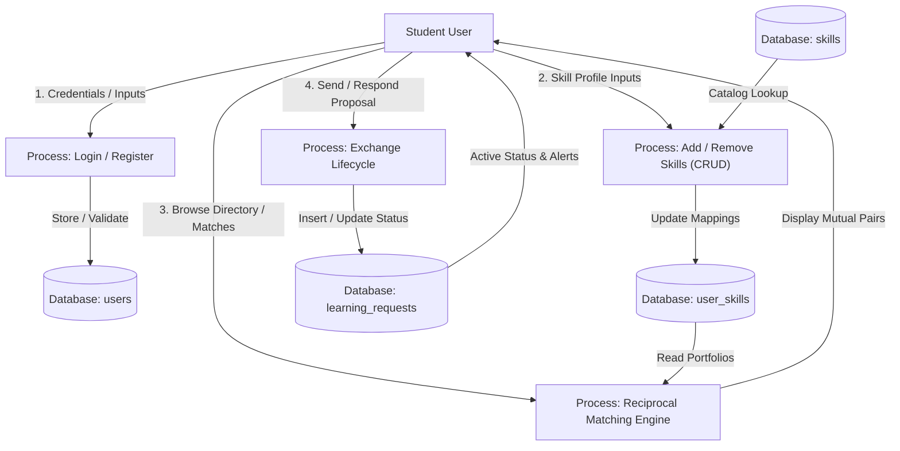

---

### USE CASE DIAGRAM
A use case diagram depicts the interactions between actors (students) and the Skill Chain platform, illustrating the system functionalities offered:

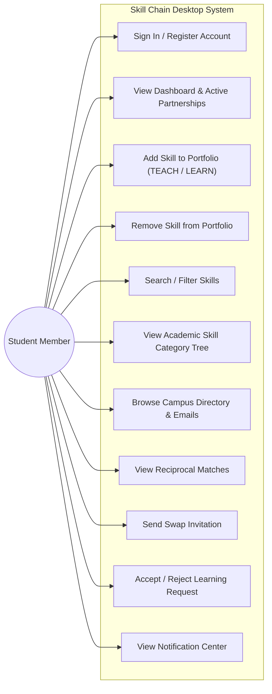

* **Actor: Student Member Use Cases:**
  * **Sign In / Register:** Authenticates existing students or registers new student accounts with salted passwords.
  * **Add Skill:** Associates skills to the student portfolio as either `TEACH` or `LEARN`.
  * **Remove Skill:** Deletes existing user-skill mappings owned by the active user.
  * **View Category Tree:** Traverses recursive N-ary category hierarchy.
  * **Browse Directory:** Inspects peer students, emails, and sends direct proposals.
  * **View Reciprocal Matches:** Computes 2-way mutual skill overlaps.
  * **Accept / Reject Request:** Updates proposal status to `ACCEPTED` or `REJECTED`.
  * **View Notifications:** Displays alerts on accepted swaps and incoming requests.

---

### ENTITY RELATIONSHIP DIAGRAM (ERD)
An entity-relationship diagram illustrates the database structure, table entities, primary keys, foreign keys, and relational cardinality:

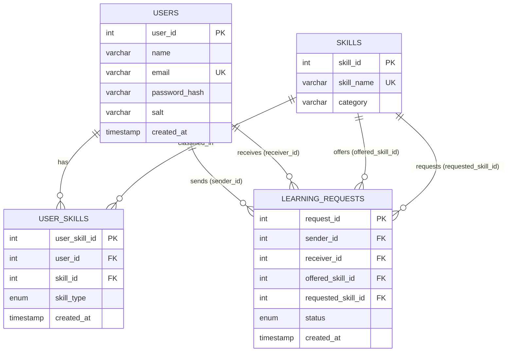

---

## 4. MODULE DESCRIPTION

The system comprises the following core functional modules:

### 1. AUTHENTICATION & REGISTRATION MODULE
Allows students to register new accounts and securely authenticate into the platform. When registering, the system validates the student's name, email structure, and password match. It generates a unique 16-byte random salt and calculates a 64-character SHA-256 hash. The login process compares incoming credentials against stored salted hashes using constant-time verification.

### 2. STUDENT DASHBOARD & ACTIVE PARTNERSHIPS MODULE
Upon successful login, the student is greeted by an executive overview featuring 4 dynamic elevated metric cards: *Skills I Teach*, *Skills I Learn*, *Reciprocal Matches*, and *Exchange Requests*. Beneath the metrics, the *Active Learning Status Tracker* presents ongoing accepted partnerships showing partner contact details and mutual teaching commitments.

### 3. MY SKILLS PORTFOLIO (CRUD) MODULE
In this section, the student manages their personal skill inventory:
* **Add Skill (Create):** Select from the master catalog or input custom skills, designating intent as `TEACH` (Offering) or `LEARN` (Seeking). Prevents duplicate additions.
* **View Skills (Read):** Displays user skills in an anti-aliased table with color-coded badges (`TEACH` in Emerald green, `LEARN` in Indigo blue).
* **Search / Filter (Read):** Filter portfolio items by keyword or exchange type.
* **Remove Skill (Delete):** Deletes unwanted skills with database cascade safety.

### 4. RECURSIVE CATEGORY TREE TAXONOMY MODULE
Renders a hierarchical N-ary tree representing university academic domains (Software Engineering, Data Systems, Visual Arts). Utilizes recursive algorithms to traverse nested branches without hardcoded loop depths, formatting an indented visual tree.

### 5. CAMPUS STUDENT DIRECTORY MODULE
Displays all registered classmates across campus in clean student cards. Each card presents the student's name, verified institutional email, skills they teach, skills they want to learn, and an immediate **"Send Request ✉"** action button.

### 6. SMART RECIPROCAL MATCHING ENGINE MODULE
Identifies bilateral study opportunities where two students have complementary needs. Powered by an optimized 4-table relational self-join query, it eliminates manual searching by surfacing verified matching pairs.

### 7. LEARNING REQUESTS & NOTIFICATION MODULE
Coordinates the negotiation lifecycle:
* **Incoming Requests:** Displays incoming proposals with **"Accept ✓"** and **"Reject ✕"** buttons.
* **Outgoing Requests:** Monitors sent proposals and real-time status badges (`PENDING`, `ACCEPTED`, `REJECTED`).
* **Notification Center:** A top-bar bell icon displays dynamic unread badges and opens an alert popup summarizing recent exchange events.

---

## 5. IMPLEMENTATION

### 5.1 JDBC DATABASE CONNECTION
Database credentials reside in an external `config.properties` file. `DatabaseConnection.java` manages connections using JDBC `DriverManager` and connection pooling best practices.

#### JAVA CODE: `DatabaseConnection.java`
```java
package com.skillchain.util;

import java.io.File;
import java.io.FileInputStream;
import java.io.InputStream;
import java.sql.Connection;
import java.sql.DriverManager;
import java.sql.SQLException;
import java.util.Properties;

public final class DatabaseConnection {
    private static final String CONFIG_FILE_NAME = "config.properties";
    private static String dbUrl;
    private static String dbUser;
    private static String dbPassword;
    private static boolean initialized = false;

    private DatabaseConnection() {}

    private static synchronized void initialize() {
        if (initialized) return;
        Properties properties = new Properties();
        File externalConfigFile = new File(CONFIG_FILE_NAME);

        try {
            if (externalConfigFile.exists()) {
                try (InputStream fis = new FileInputStream(externalConfigFile)) {
                    properties.load(fis);
                }
            } else {
                try (InputStream cis = DatabaseConnection.class.getClassLoader().getResourceAsStream(CONFIG_FILE_NAME)) {
                    if (cis != null) properties.load(cis);
                }
            }
            dbUrl = properties.getProperty("db.url");
            dbUser = properties.getProperty("db.user");
            dbPassword = properties.getProperty("db.password", "");
            Class.forName("com.mysql.cj.jdbc.Driver");
            initialized = true;
        } catch (Exception e) {
            throw new DatabaseException("Failed to initialize database: " + e.getMessage(), e);
        }
    }

    public static Connection getConnection() throws SQLException {
        if (!initialized) initialize();
        return DriverManager.getConnection(dbUrl, dbUser, dbPassword);
    }

    public static boolean testConnection() {
        try (Connection conn = getConnection()) {
            return conn != null && !conn.isClosed();
        } catch (Exception e) {
            return false;
        }
    }
}
```

#### CONFIGURATION PROPERTIES: `config.properties`
```properties
db.url=jdbc:mysql://localhost:3306/skill_chain_db?useSSL=false&allowPublicKeyRetrieval=true&serverTimezone=UTC
db.user=root
db.password=root
```

---

### 5.2 MAIN CLASS LAUNCHER
Initializes the Swing UI on the Event Dispatch Thread (EDT) and launches `LoginRegisterFrame`.

#### JAVA CODE: `Main.java`
```java
package com.skillchain;

import com.skillchain.ui.LoginRegisterFrame;
import javax.swing.SwingUtilities;
import javax.swing.UIManager;

public class Main {
    public static void main(String[] args) {
        SwingUtilities.invokeLater(() -> {
            try {
                UIManager.setLookAndFeel(UIManager.getSystemLookAndFeelClassName());
            } catch (Exception ignored) {}
            new LoginRegisterFrame().setVisible(true);
        });
    }
}
```

---

### 5.3 LOGIN & REGISTRATION MODULE

#### SCREENSHOTS:
**Figure 5.1: Student Login Screen**  
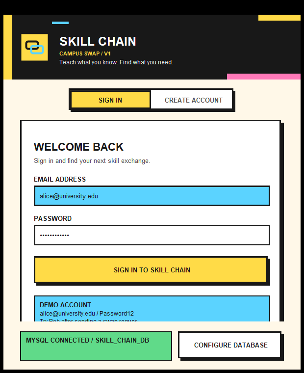

**Figure 5.2: New Student Registration Screen**  
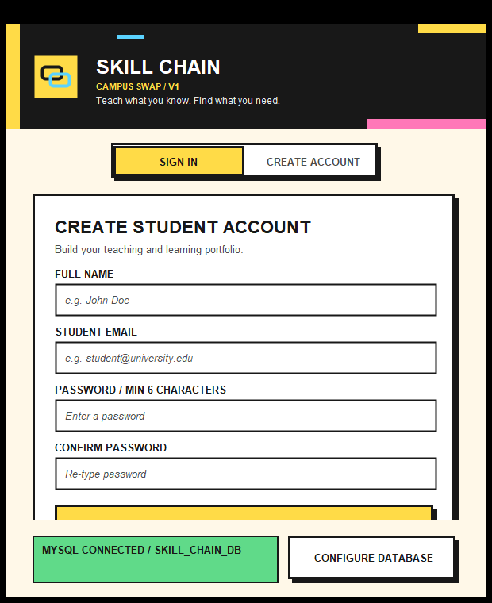

#### JAVA CODE: `LoginRegisterFrame.java` (Extract)
```java
package com.skillchain.ui;

import com.skillchain.model.User;
import com.skillchain.service.UserService;
import com.skillchain.util.DuplicateEmailException;
import com.skillchain.util.InvalidLoginException;
import javax.swing.*;
import java.awt.*;

public class LoginRegisterFrame extends JFrame {
    private final UserService userService = new UserService();
    private ModernTextField txtLoginEmail;
    private ModernPasswordField txtLoginPassword;
    private ModernTextField txtRegName, txtRegEmail;
    private ModernPasswordField txtRegPassword, txtRegConfirmPassword;
    private CardLayout cardLayout;
    private JPanel cardContainer;

    public LoginRegisterFrame() {
        setTitle("Skill Chain - Student Login & Registration");
        setSize(520, 710);
        setDefaultCloseOperation(JFrame.EXIT_ON_CLOSE);
        setLocationRelativeTo(null);
        initUI();
    }

    private void handleLogin() {
        String email = txtLoginEmail.getText().trim();
        String password = new String(txtLoginPassword.getPassword());
        try {
            User user = userService.login(email, password);
            JOptionPane.showMessageDialog(this, "Login Successful! Welcome, " + user.getName(), 
                                          "Success", JOptionPane.INFORMATION_MESSAGE);
            new MainFrame(user, this).setVisible(true);
            setVisible(false);
        } catch (InvalidLoginException ex) {
            JOptionPane.showMessageDialog(this, ex.getMessage(), "Login Failed", JOptionPane.ERROR_MESSAGE);
        }
    }

    private void handleRegister() {
        String name = txtRegName.getText().trim();
        String email = txtRegEmail.getText().trim();
        String password = new String(txtRegPassword.getPassword());
        String confirm = new String(txtRegConfirmPassword.getPassword());

        if (!password.equals(confirm)) {
            JOptionPane.showMessageDialog(this, "Passwords do not match!", "Error", JOptionPane.ERROR_MESSAGE);
            return;
        }
        try {
            userService.register(name, email, password);
            JOptionPane.showMessageDialog(this, "Account created successfully! Please sign in.", 
                                          "Success", JOptionPane.INFORMATION_MESSAGE);
            cardLayout.show(cardContainer, "LOGIN");
        } catch (DuplicateEmailException ex) {
            JOptionPane.showMessageDialog(this, ex.getMessage(), "Registration Error", JOptionPane.ERROR_MESSAGE);
        }
    }
}
```

#### JDBC DATA ACCESS CODE: `UserDaoImpl.java` (Extract)
```java
// SQL Insert for User Registration with Salted SHA-256 Hash
public User save(User user) throws DuplicateEmailException, SQLException {
    final String sql = "INSERT INTO users (name, email, password_hash, salt) VALUES (?, ?, ?, ?)";
    try (Connection conn = DatabaseConnection.getConnection();
         PreparedStatement stmt = conn.prepareStatement(sql, Statement.RETURN_GENERATED_KEYS)) {
        stmt.setString(1, user.getName());
        stmt.setString(2, user.getEmail().toLowerCase().trim());
        stmt.setString(3, user.getPasswordHash());
        stmt.setString(4, user.getSalt());
        stmt.executeUpdate();
        try (ResultSet rs = stmt.getGeneratedKeys()) {
            if (rs.next()) user.setId(rs.getInt(1));
        }
        return user;
    }
}

// SQL Lookup for User Authentication
public Optional<User> findByEmail(String email) throws SQLException {
    final String sql = "SELECT user_id, name, email, password_hash, salt, created_at FROM users WHERE LOWER(email) = ?";
    try (Connection conn = DatabaseConnection.getConnection();
         PreparedStatement stmt = conn.prepareStatement(sql)) {
        stmt.setString(1, email.toLowerCase().trim());
        try (ResultSet rs = stmt.executeQuery()) {
            if (rs.next()) return Optional.of(mapRowToUser(rs));
        }
    }
    return Optional.empty();
}
```

---

### 5.4 STUDENT DASHBOARD & ACTIVE PARTNERSHIPS

#### SCREENSHOT:
**Figure 5.3: Main Dashboard Overview & Active Partnerships**  
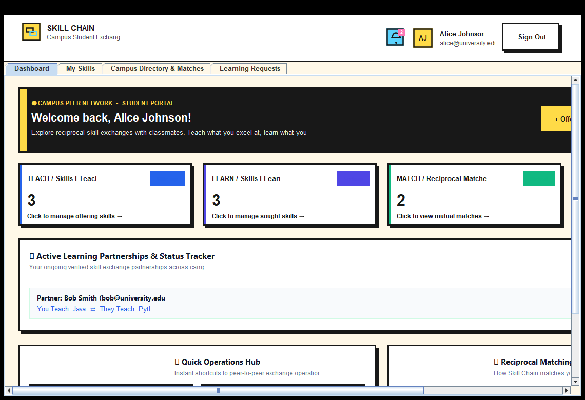

#### JAVA CODE: `MainFrame.java` (Dashboard Extract)
```java
private JPanel createDashboardPanel() {
    JPanel panel = new JPanel(new BorderLayout(0, 20));
    panel.setBackground(new Color(248, 250, 252));
    panel.setBorder(new EmptyBorder(24, 24, 24, 24));

    // 4 Dynamic Metric KPI Cards
    JPanel metricsGrid = new JPanel(new GridLayout(1, 4, 16, 0));
    metricsGrid.setOpaque(false);
    metricsGrid.add(createMetricCard("Skills I Teach", lblDashTeach, new Color(5, 150, 105)));
    metricsGrid.add(createMetricCard("Skills I Learn", lblDashLearn, new Color(37, 99, 235)));
    metricsGrid.add(createMetricCard("Reciprocal Matches", lblDashMatches, new Color(217, 119, 6)));
    metricsGrid.add(createMetricCard("Exchange Requests", lblDashRequests, new Color(147, 51, 234)));
    panel.add(metricsGrid, BorderLayout.NORTH);

    // Active Learning Status Tracker Container
    activePartnershipsContainer = new JPanel();
    activePartnershipsContainer.setLayout(new BoxLayout(activePartnershipsContainer, BoxLayout.Y_AXIS));
    activePartnershipsContainer.setBackground(Color.WHITE);
    panel.add(new JScrollPane(activePartnershipsContainer), BorderLayout.CENTER);
    return panel;
}
```

#### JDBC DATA ACCESS CODE: Active Partnerships Query
```java
// Retrieves all confirmed partnerships where proposal status = 'ACCEPTED'
final String sql =
    "SELECT lr.request_id, " +
    "       CASE WHEN lr.sender_id = ? THEN u_recv.name ELSE u_send.name END AS partner_name, " +
    "       CASE WHEN lr.sender_id = ? THEN u_recv.email ELSE u_send.email END AS partner_email, " +
    "       CASE WHEN lr.sender_id = ? THEN s_off.skill_name ELSE s_req.skill_name END AS you_teach, " +
    "       CASE WHEN lr.sender_id = ? THEN s_req.skill_name ELSE s_off.skill_name END AS partner_teaches, " +
    "       lr.status, lr.created_at " +
    "FROM learning_requests lr " +
    "JOIN users u_send ON lr.sender_id = u_send.user_id " +
    "JOIN users u_recv ON lr.receiver_id = u_recv.user_id " +
    "JOIN skills s_off ON lr.offered_skill_id = s_off.skill_id " +
    "JOIN skills s_req ON lr.requested_skill_id = s_req.skill_id " +
    "WHERE (lr.sender_id = ? OR lr.receiver_id = ?) AND lr.status = 'ACCEPTED' " +
    "ORDER BY lr.created_at DESC";
```

---

### 5.5 MY SKILLS PORTFOLIO (CRUD OPERATIONS)

#### SCREENSHOT:
**Figure 5.4: My Skills Portfolio Management (CRUD)**  
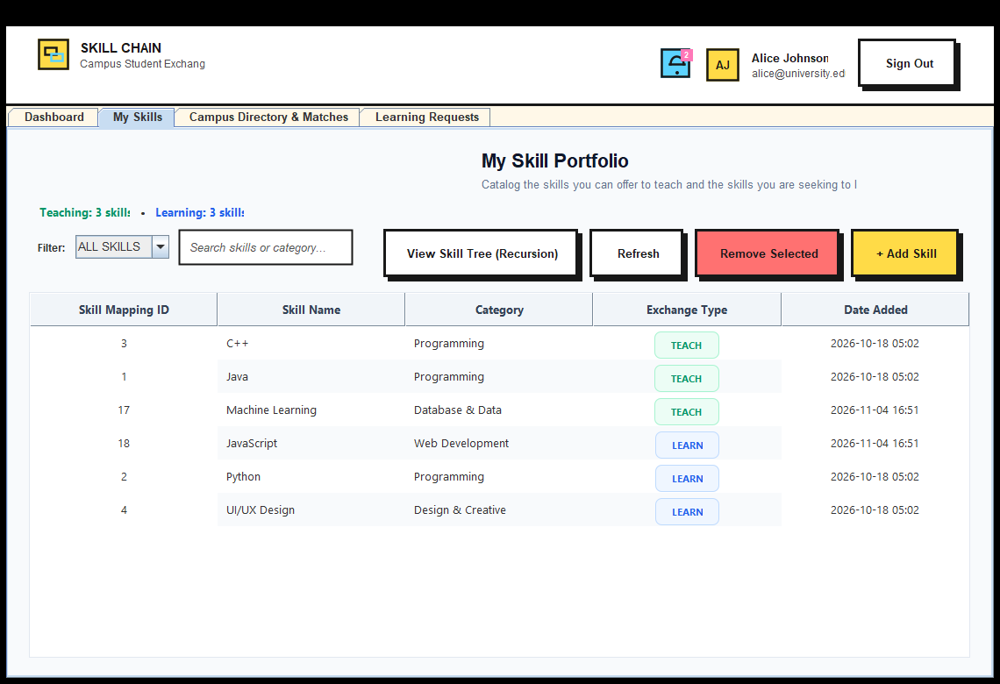

#### JAVA CODE: `SkillDaoImpl.java` (CRUD Operations)
```java
// CREATE: Associate a skill to user portfolio
public void addUserSkill(int userId, int skillId, SkillType skillType) throws DuplicateSkillException, SQLException {
    if (hasUserSkill(userId, skillId, skillType)) {
        throw new DuplicateSkillException("You have already added this skill under " + skillType.name() + ".");
    }
    final String sql = "INSERT INTO user_skills (user_id, skill_id, skill_type) VALUES (?, ?, ?)";
    try (Connection conn = DatabaseConnection.getConnection();
         PreparedStatement stmt = conn.prepareStatement(sql)) {
        stmt.setInt(1, userId);
        stmt.setInt(2, skillId);
        stmt.setString(3, skillType.name());
        stmt.executeUpdate();
    }
}

// READ: Retrieve user portfolio skills
public List<UserSkill> getUserSkills(int userId) throws SQLException {
    final String sql = "SELECT us.user_skill_id, us.user_id, us.skill_id, s.skill_name, s.category, " +
                       "us.skill_type, us.created_at " +
                       "FROM user_skills us " +
                       "JOIN skills s ON us.skill_id = s.skill_id " +
                       "WHERE us.user_id = ? ORDER BY us.skill_type ASC, s.skill_name ASC";
    List<UserSkill> list = new ArrayList<>();
    try (Connection conn = DatabaseConnection.getConnection();
         PreparedStatement stmt = conn.prepareStatement(sql)) {
        stmt.setInt(1, userId);
        try (ResultSet rs = stmt.executeQuery()) {
            while (rs.next()) list.add(mapRowToUserSkill(rs));
        }
    }
    return list;
}

// DELETE: Remove skill from portfolio
public void removeUserSkill(int userSkillId, int userId) throws SQLException {
    final String sql = "DELETE FROM user_skills WHERE user_skill_id = ? AND user_id = ?";
    try (Connection conn = DatabaseConnection.getConnection();
         PreparedStatement stmt = conn.prepareStatement(sql)) {
        stmt.setInt(1, userSkillId);
        stmt.setInt(2, userId);
        stmt.executeUpdate();
    }
}
```

---

### 5.6 RECURSIVE CATEGORY TREE TAXONOMY

#### SCREENSHOT:
**Figure 5.5: Academic Skill Category Hierarchy Dialog (Recursion)**  
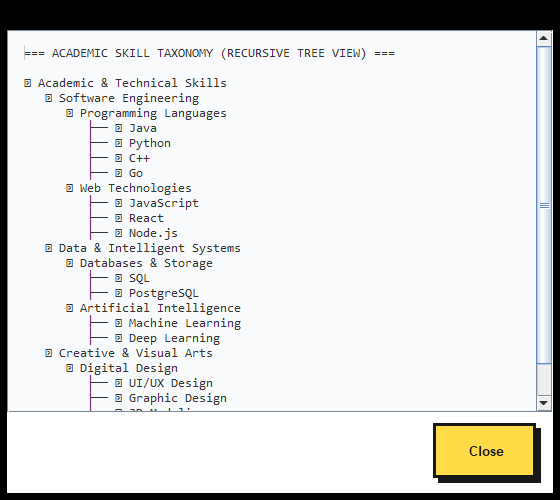

#### JAVA CODE: `SkillTreeUtil.java` (Recursive Traversal)
```java
package com.skillchain.util;

import com.skillchain.model.SkillCategoryNode;

public final class SkillTreeUtil {
    // RECURSIVE METHOD: Walks N-ary tree and formats indented visual outline
    public static void traverseTreeRecursive(SkillCategoryNode node, int depth, StringBuilder buffer) {
        if (node == null) return; // Base Case

        String indent = "   ".repeat(depth);
        buffer.append(indent).append("📂 ").append(node.getName()).append("
");

        for (String skill : node.getSkills()) {
            buffer.append(indent).append("   ├── ⚡ ").append(skill).append("
");
        }

        // Recursive Step: Traverse child category nodes
        for (SkillCategoryNode child : node.getChildren()) {
            traverseTreeRecursive(child, depth + 1, buffer);
        }
    }
}
```

---

### 5.7 CAMPUS STUDENT DIRECTORY & DIRECT PROPOSALS

#### SCREENSHOT:
**Figure 5.6: Campus Student Directory Screen**  
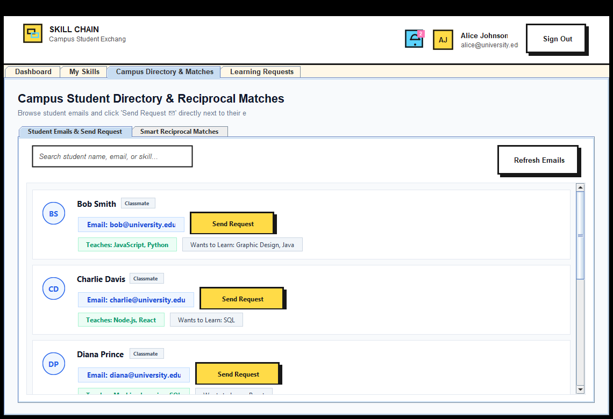

#### JAVA CODE & JDBC QUERY: `UserDaoImpl.java`
```java
// Aggregates peer student details, emails, and distinct TEACH/LEARN skill lists
public List<PeerStudent> findAllPeersWithSkills(int excludeUserId) throws SQLException {
    final String sql =
        "SELECT u.user_id, u.name, u.email, " +
        "       COALESCE(GROUP_CONCAT(DISTINCT CASE WHEN us.skill_type = 'TEACH' THEN s.skill_name END SEPARATOR ', '), 'None listed yet') AS teach_skills, " +
        "       COALESCE(GROUP_CONCAT(DISTINCT CASE WHEN us.skill_type = 'LEARN' THEN s.skill_name END SEPARATOR ', '), 'None listed yet') AS learn_skills " +
        "FROM users u " +
        "LEFT JOIN user_skills us ON u.user_id = us.user_id " +
        "LEFT JOIN skills s ON us.skill_id = s.skill_id " +
        "WHERE u.user_id != ? " +
        "GROUP BY u.user_id, u.name, u.email " +
        "ORDER BY u.name ASC";

    List<PeerStudent> peers = new ArrayList<>();
    try (Connection conn = DatabaseConnection.getConnection();
         PreparedStatement stmt = conn.prepareStatement(sql)) {
        stmt.setInt(1, excludeUserId);
        try (ResultSet rs = stmt.executeQuery()) {
            while (rs.next()) {
                peers.add(new PeerStudent(
                    rs.getInt("user_id"), rs.getString("name"), rs.getString("email"),
                    rs.getString("teach_skills"), rs.getString("learn_skills")
                ));
            }
        }
    }
    return peers;
}
```

---

### 5.8 SMART RECIPROCAL MATCHING ENGINE

#### SCREENSHOT:
**Figure 5.7: Smart Reciprocal Matches Screen**  
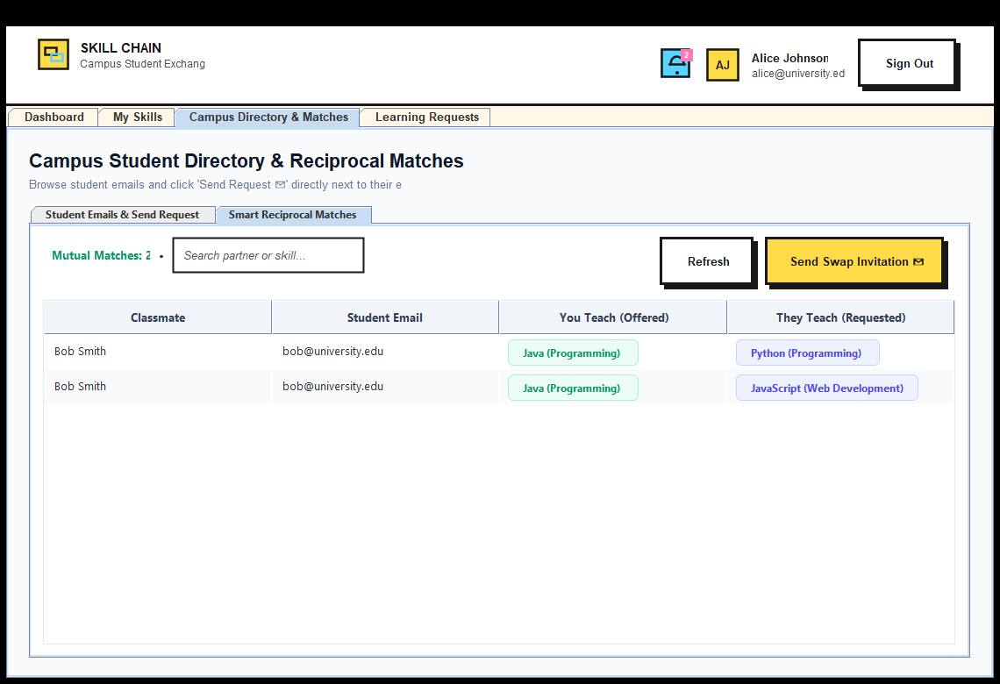

#### JAVA CODE: `MatchingService.java`
```java
package com.skillchain.service;

import com.skillchain.model.ReciprocalMatch;
import com.skillchain.util.DatabaseConnection;
import java.sql.*;
import java.util.*;

public class MatchingService {
    // 4-Table Relational Self-Join computing dual-conditional skill synergy
    private static final String RECIPROCAL_MATCH_SQL =
        "SELECT " +
        "    u_partner.user_id AS partner_id, " +
        "    u_partner.name AS partner_name, " +
        "    u_partner.email AS partner_email, " +
        "    s_offer.skill_id AS user_offered_id, " +
        "    s_offer.skill_name AS user_offered_name, " +
        "    s_partner.skill_id AS partner_offered_id, " +
        "    s_partner.skill_name AS partner_offered_name " +
        "FROM user_skills my_teach " +
        "JOIN user_skills partner_learn " +
        "    ON my_teach.skill_id = partner_learn.skill_id " +
        "   AND my_teach.skill_type = 'TEACH' " +
        "   AND partner_learn.skill_type = 'LEARN' " +
        "   AND partner_learn.user_id != my_teach.user_id " +
        "JOIN user_skills partner_teach " +
        "    ON partner_teach.user_id = partner_learn.user_id " +
        "   AND partner_teach.skill_type = 'TEACH' " +
        "JOIN user_skills my_learn " +
        "    ON my_learn.skill_id = partner_teach.skill_id " +
        "   AND my_learn.user_id = my_teach.user_id " +
        "   AND my_learn.skill_type = 'LEARN' " +
        "JOIN users u_partner ON u_partner.user_id = partner_learn.user_id " +
        "JOIN skills s_offer ON s_offer.skill_id = my_teach.skill_id " +
        "JOIN skills s_partner ON s_partner.skill_id = partner_teach.skill_id " +
        "WHERE my_teach.user_id = ? " +
        "ORDER BY u_partner.name ASC";

    public List<ReciprocalMatch> findReciprocalMatches(int currentUserId) throws SQLException {
        List<ReciprocalMatch> matches = new ArrayList<>();
        try (Connection conn = DatabaseConnection.getConnection();
             PreparedStatement stmt = conn.prepareStatement(RECIPROCAL_MATCH_SQL)) {
            stmt.setInt(1, currentUserId);
            try (ResultSet rs = stmt.executeQuery()) {
                while (rs.next()) {
                    matches.add(new ReciprocalMatch(
                        rs.getInt("partner_id"), rs.getString("partner_name"), rs.getString("partner_email"),
                        rs.getInt("user_offered_id"), rs.getString("user_offered_name"), "",
                        rs.getInt("partner_offered_id"), rs.getString("partner_offered_name"), ""
                    ));
                }
            }
        }
        return matches;
    }
}
```

---

### 5.9 LEARNING REQUESTS MANAGEMENT (ACCEPT / REJECT)

#### SCREENSHOTS:
**Figure 5.8: Incoming Learning Requests (Accept / Reject Controls)**  
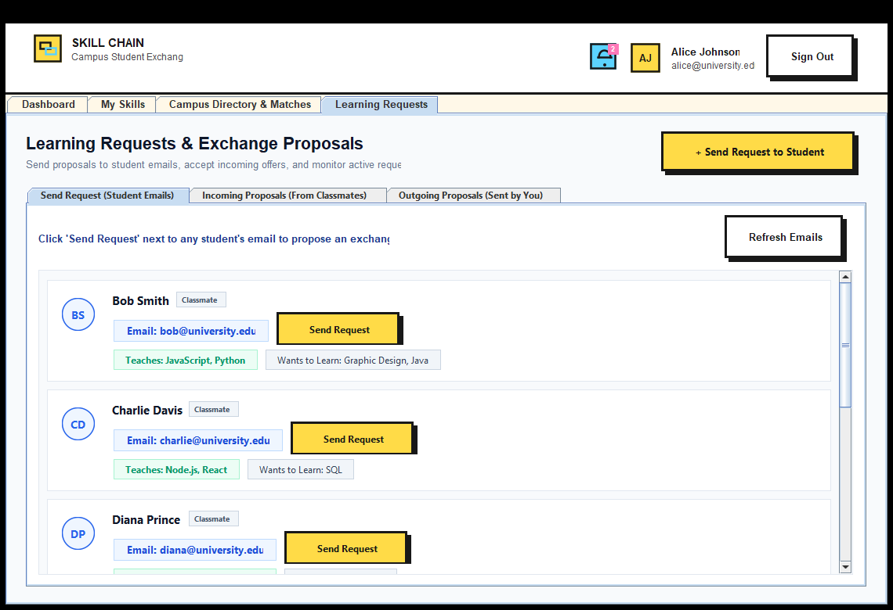

**Figure 5.9: Outgoing Learning Requests Tracking**  
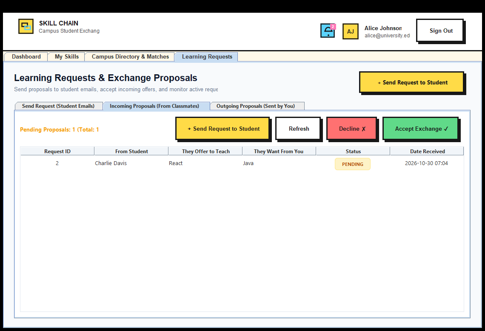

#### JAVA CODE: `LearningRequestDaoImpl.java` (Extract)
```java
// Create a new swap proposal
public LearningRequest save(LearningRequest request) throws SQLException {
    final String sql = "INSERT INTO learning_requests (sender_id, receiver_id, offered_skill_id, requested_skill_id, status) " +
                       "VALUES (?, ?, ?, ?, ?)";
    try (Connection conn = DatabaseConnection.getConnection();
         PreparedStatement stmt = conn.prepareStatement(sql, Statement.RETURN_GENERATED_KEYS)) {
        stmt.setInt(1, request.getSenderId());
        stmt.setInt(2, request.getReceiverId());
        stmt.setInt(3, request.getOfferedSkillId());
        stmt.setInt(4, request.getRequestedSkillId());
        stmt.setString(5, request.getStatus() != null ? request.getStatus() : "PENDING");
        stmt.executeUpdate();
        try (ResultSet rs = stmt.getGeneratedKeys()) {
            if (rs.next()) request.setRequestId(rs.getInt(1));
        }
        return request;
    }
}

// Update proposal status to ACCEPTED or REJECTED
public boolean updateStatus(int requestId, String newStatus) throws SQLException {
    final String sql = "UPDATE learning_requests SET status = ? WHERE request_id = ?";
    try (Connection conn = DatabaseConnection.getConnection();
         PreparedStatement stmt = conn.prepareStatement(sql)) {
        stmt.setString(1, newStatus);
        stmt.setInt(2, requestId);
        return stmt.executeUpdate() > 0;
    }
}
```

---

### 5.10 STUDENT NOTIFICATION CENTER

#### SCREENSHOT:
**Figure 5.10: Student Notification Center Modal Dialog**  
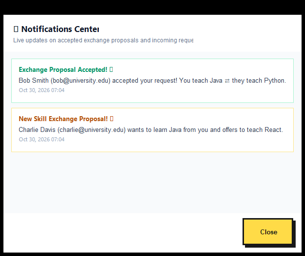

#### JAVA CODE: `RequestService.java` (Notification Extract)
```java
public List<AppNotification> getNotifications(int userId) throws SQLException {
    List<AppNotification> notifications = new ArrayList<>();
    final String acceptedSql =
        "SELECT lr.request_id, u_recv.name AS partner_name, u_recv.email AS partner_email, " +
        "       s_off.skill_name AS off_skill, s_req.skill_name AS req_skill, lr.created_at " +
        "FROM learning_requests lr " +
        "JOIN users u_recv ON lr.receiver_id = u_recv.user_id " +
        "JOIN skills s_off ON lr.offered_skill_id = s_off.skill_id " +
        "JOIN skills s_req ON lr.requested_skill_id = s_req.skill_id " +
        "WHERE lr.sender_id = ? AND lr.status = 'ACCEPTED' ORDER BY lr.created_at DESC";

    try (Connection conn = DatabaseConnection.getConnection();
         PreparedStatement stmt = conn.prepareStatement(acceptedSql)) {
        stmt.setInt(1, userId);
        try (ResultSet rs = stmt.executeQuery()) {
            while (rs.next()) {
                notifications.add(new AppNotification(
                    rs.getInt("request_id"), AppNotification.NotificationType.ACCEPTED,
                    "Exchange Proposal Accepted! 🎉",
                    rs.getString("partner_name") + " accepted your request to trade " + rs.getString("off_skill") + " for " + rs.getString("req_skill"),
                    rs.getString("partner_name"), rs.getString("partner_email"), rs.getTimestamp("created_at").toLocalDateTime()
                ));
            }
        }
    }
    return notifications;
}
```

---

## 6. CONCLUSION

In conclusion, our **Skill Chain: Campus Peer-to-Peer Skill Exchange Platform** implemented in Core Java using JDBC and MySQL successfully addresses the core academic requirements of managing student skill portfolios, discovering mutual learning partners, and coordinating exchange agreements. The utilization of **JDBC (Java Database Connectivity)** allowed seamless, leak-proof interaction between the Java application and the MySQL database engine through parameterized `PreparedStatement` transactions.

The project emphasized the practical application of essential **Object-Oriented Programming (OOP)** principles:
* **Abstraction** through base entity contracts (`Person.java`),
* **Inheritance** through derived domain models (`User.java`, `PeerStudent.java`),
* **Encapsulation** through strict private member attributes and validated accessors,
* **Dynamic Polymorphism** via method overriding (`getRole()`, `getSummary()`),
* **Static Polymorphism** via method overloading (`search()`, `getUserSkills()`),
* **Data Structures and Recursion** via an N-ary category taxonomy tree (`SkillTreeUtil.java`),
* **Security Engineering** via cryptographically salted SHA-256 password hashing (`PasswordUtil.java`).

Additionally, the project's adherence to established database management principles—specifically relational schema normalization into **Third Normal Form (3NF)**, cascading foreign keys, domain check constraints, and multi-table self-joins—ensures a rock-solid foundation for data integrity, atomicity, and concurrency.

Through this project, we gained invaluable real-world insights into full-stack Java application architecture, relational database persistence, and software engineering best practices. The system provides an engaging, user-friendly interface that empowers university students to share knowledge freely, contributing to a more collaborative and academically enriched campus community.

---

## 7. REFERENCES

1. **JAVA – The Complete Reference (12th Edition)** by Herbert Schildt, Oracle Press / McGraw-Hill.
2. **Database System Concepts (7th Edition)** by Abraham Silberschatz, Henry F. Korth, and S. Sudarshan, McGraw-Hill.
3. **Core Java Volume I – Fundamentals (12th Edition)** by Cay S. Horstmann, Prentice Hall.
4. **MySQL 8.4 Reference Manual & Connector/J Documentation**, Oracle Corporation.
5. **Cryptography and Network Security: Principles and Practice (7th Edition)** by William Stallings, Pearson Education.
