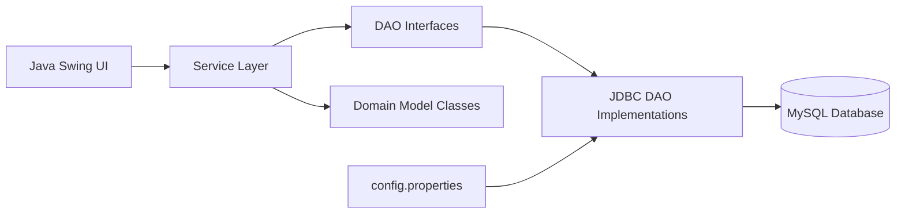
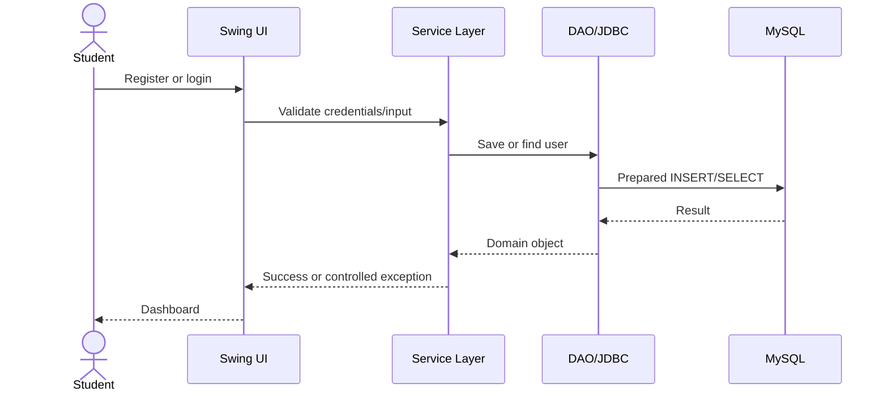
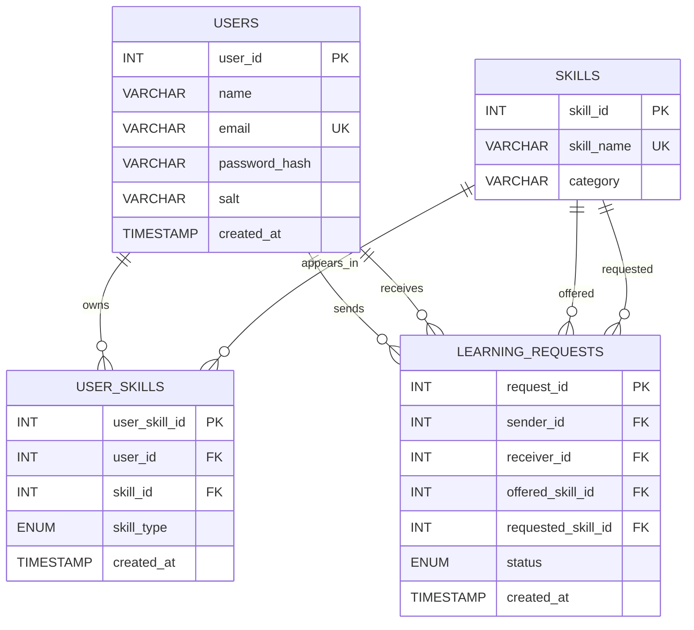
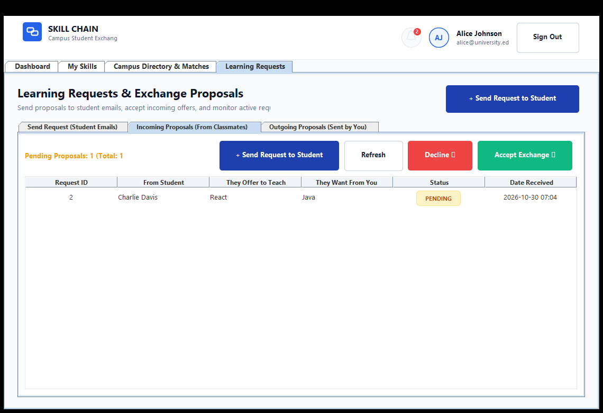

# Skill Chain — Final Project Report

> **Submission draft:** Replace every `[TO BE COMPLETED]` item with the team’s verified information before submission. Do not claim a test or screenshot until it has actually been executed or captured.

## Preliminary Pages

### Bonafide Certificate

This is to certify that the project titled **"Skill Chain: Campus Peer-to-Peer Skill Exchange Platform"** was completed by:

1. Name: __________________________________________________ &emsp;&emsp; Register No: ____________________________  
2. Name: __________________________________________________ &emsp;&emsp; Register No: ____________________________  

under the guidance of our course faculty during the academic year **2025–2026** in partial fulfillment of the requirements in **Object-Oriented Programming (Java)** and **Database Management Systems (MySQL)**.

**Institution:** __________________________________________________  
**Department:** Department of Computer Science and Engineering  
**Date:** ________________________  

---------------------------------------------------- &emsp;&emsp;&emsp;&emsp;&emsp;&emsp;&emsp;&emsp; ----------------------------------------------------  
**SUPERVISOR / FACULTY IN-CHARGE** &emsp;&emsp;&emsp;&emsp;&emsp;&emsp;&emsp;&emsp;&emsp;&emsp;&emsp;&emsp; **HEAD OF THE DEPARTMENT**  

### Student Declaration

We / I declare that this project is our original work and that all sources used in its design and implementation have been acknowledged.

**Student Signature(s):**  
1. Name: _____________________________________________ &emsp;&emsp; Signature: ____________________________  
2. Name: _____________________________________________ &emsp;&emsp; Signature: ____________________________  

### Acknowledgement

We thank the **Principal**, the **Head of the Department of Computer Science and Engineering**, and our **Course Instructors** for their guidance, computing facilities, and support in completing this Java OOPs and DBMS project.

**Student Name(s):**  
1. __________________________________________________  
2. __________________________________________________  

### Abstract

Skill Chain is a Java Swing desktop application that enables students to exchange academic and technical skills without monetary transactions. Students can register, authenticate, maintain teaching and learning skill portfolios, discover reciprocal matches, send exchange requests, and accept or reject requests. The application demonstrates core Java OOP concepts through domain classes, inheritance, abstraction, interfaces, method overriding, method overloading, encapsulation, packages, and custom exception handling. MySQL stores users, skills, user-skill associations, and learning requests. JDBC and prepared statements connect the service layer to the relational database and support CRUD operations.

## Chapter 1: Introduction

### 1.1 Background

Students often know skills that their peers want to learn while seeking other skills in return. Skill Chain provides a structured platform for discovering and managing these reciprocal exchanges.

### 1.2 Problem Statement

Informal skill exchange is difficult to discover, coordinate, and track. The system therefore needs authenticated users, searchable skills, reciprocal matching, and request status management.

### 1.3 Objectives

1. Provide secure student registration and login.
2. Store and retrieve student skills using MySQL.
3. Identify two-way teaching and learning matches.
4. Allow students to create, view, update, and remove exchange-related records.
5. Demonstrate the required Java OOP and DBMS concepts in an integrated application.

### 1.4 Scope

The current implementation is a local desktop application for campus use. It does not provide a web server, cloud deployment, messaging, or an administrator module.

## Chapter 2: Requirements and Feasibility

### 2.1 Functional Requirements

| ID | Requirement | Implemented feature |
|---|---|---|
| FR-01 | Register a student | `UserService.register` and `UserDaoImpl.save` |
| FR-02 | Authenticate a student | `UserService.login` and password verification |
| FR-03 | Add and remove skills | `SkillService` and `SkillDaoImpl` |
| FR-04 | Search skills | Overloaded `search` methods |
| FR-05 | Find reciprocal matches | `MatchingService` SQL join |
| FR-06 | Create an exchange request | `RequestService.sendRequest` |
| FR-07 | Accept or reject a request | `RequestService.acceptRequest` and `rejectRequest` |
| FR-08 | View partnerships and notifications | `RequestService` queries and Swing panels |

### 2.2 Non-functional Requirements

- Java 17 or later.
- MySQL 8.0 or later.
- JDBC prepared statements for database access.
- Private configuration file for database credentials.
- Input validation and user-facing error handling.

### 2.3 Feasibility

- **Technical:** feasible using Java Swing, JDBC, and MySQL.
- **Operational:** runs as a local desktop application with MySQL available on the configured host.
- **Economic:** uses Java and MySQL without paid project dependencies.
- **Schedule:** implementation is complete; report completion, live testing, and screenshots remain required before the submission deadline.

## Chapter 3: System Analysis and Design

### 3.1 System Architecture

### 3.2 Main Workflow

### 3.3 Core OOP Implementation

| Concept | Actual implementation | Demonstration file |
|---|---|---|
| Encapsulation | Private fields and validated accessors | `model/Person.java`, `model/User.java`, `model/Skill.java` |
| Inheritance | `User` and `PeerStudent` extend `Person` | `model/User.java`, `model/PeerStudent.java` |
| Abstraction | Abstract `Person`, DAO interfaces, generic `Searchable<T>` | `model/Person.java`, `dao/*.java` |
| Runtime polymorphism | Subclasses override `getRole()` and `getSummary()` | `model/User.java` |
| Compile-time polymorphism | Overloaded `search` and `getUserSkills` methods | `dao/SkillDao.java`, `service/SkillService.java` |
| Packages | `model`, `dao`, `service`, `ui`, and `util` namespaces | `src/main/java/com/skillchain` |
| Exception handling | Checked custom exceptions and SQL exception handling | `util/*Exception.java`, service and UI classes |
| Composition | User-skill and learning-request domain records | `model/UserSkill.java`, `model/LearningRequest.java` |

## Chapter 4: Database Design

### 4.1 ER Diagram

### 4.2 Table Summary

| Table | Purpose | Key constraints |
|---|---|---|
| `users` | Student accounts | Primary key, unique email, email check |
| `skills` | Global skill catalogue | Primary key, unique skill name |
| `user_skills` | User-to-skill junction table | Two foreign keys, unique user/skill/type combination |
| `learning_requests` | Exchange proposals | Four foreign keys, status enum, no self-request check |

### 4.3 Normalization and Integrity

The schema separates users, skills, and relationships instead of duplicating skill names in user rows. Foreign keys enforce referential integrity, `ON DELETE CASCADE` removes dependent associations when a referenced user or skill is deleted, and unique constraints prevent duplicate records.

## Chapter 5: Implementation

### 5.1 Database Connectivity

`DatabaseConnection` loads `config.properties`, registers the MySQL driver, and returns JDBC connections. DAOs use `PreparedStatement` and try-with-resources so parameters are bound safely and resources are closed automatically.

### 5.2 CRUD Integration

| CRUD operation | Application action | Database operation |
|---|---|---|
| Create | Register user, add skill, send request | `INSERT` |
| Read | Login lookup, skill list, matches, requests | `SELECT` |
| Update | Accept or reject request | `UPDATE learning_requests` |
| Delete | Remove a skill from the current user profile | `DELETE user_skills` |

The complete mapping and demonstration steps are in [`CRUD_DEMONSTRATION.md`](CRUD_DEMONSTRATION.md).

### 5.3 Security

Passwords are stored as salted SHA-256 hashes rather than plaintext. Database credentials are excluded from Git by `.gitignore`; each user must create a local `config.properties` from the example file.

## Chapter 6: Verification and Test Plan

The verification plan is documented in [`TEST_PLAN.md`](TEST_PLAN.md). The repository also includes a database-independent Java smoke test at `src/test/java/com/skillchain/verification/CoreOopVerification.java`.

### 6.1 Verification Status

| Verification area | Status |
|---|---|
| Production Java compilation | Passed with `javac --release 17` |
| Core OOP smoke test | Run with `verify.bat` or the documented Java command |
| MySQL schema execution | To be run on the team’s MySQL installation |
| End-to-end CRUD verification | To be run with MySQL and recorded in screenshots |
| Swing UI screenshots | To be captured by the team |

## Chapter 7: Security, Limitations, and Maintenance

### 7.1 Security Measures

- Prepared statements reduce SQL injection risk.
- Passwords are salted and hashed.
- Database credentials are externalized and ignored by Git.
- User-skill deletion checks ownership using both record ID and user ID.
- Foreign keys protect relationship integrity.

### 7.2 Limitations

- The current system is a local Swing application.
- It requires a reachable MySQL server and local configuration.
- There is no administrator role or account moderation workflow.
- There is no automated cloud deployment or multi-user server session management.
- SHA-256 is suitable for demonstrating hashing, but production authentication should use a dedicated password-hashing function such as Argon2, bcrypt, or scrypt.

### 7.3 Maintenance Plan

Future maintenance should include dependency updates, database backups, improved password hashing, automated integration tests, centralized logging, and clearer separation of configuration for development and production environments.

## Chapter 8: Conclusion and Future Work

Skill Chain integrates Java OOP concepts with a relational MySQL database rather than functioning as a presentation-only application. The project demonstrates abstraction, inheritance, encapsulation, polymorphism, packages, exception handling, JDBC connectivity, relational design, and CRUD actions. Future work can include administrator controls, chat or notifications over a network, richer search filters, scheduling, password reset, and deployment as a multi-user service.

## References

1. Oracle Java documentation for classes, inheritance, interfaces, exceptions, and JDBC.
2. MySQL 8.0 Reference Manual for SQL, constraints, and foreign keys.
3. MySQL Connector/J documentation.
4. Project source code and schema in this repository.

## Appendix A: SQL Schema

The authoritative schema is [`schema.sql`](../schema.sql). Include a printed copy of that file in the submitted report appendix.

## Appendix B: Output Screenshots

The following high-resolution output screenshots were captured directly from the live running application connected to MySQL:

1. **Student Login Screen:**  
   

2. **New Student Registration Screen:**  
   

3. **Main Dashboard Overview & Active Partnerships:**  
   

4. **My Skills Portfolio Management:**  
   

5. **Academic Skill Category Tree (Recursion):**  
   

6. **Campus Student Directory:**  
   

7. **Smart Reciprocal Matches:**  
   

8. **Incoming Learning Requests:**  
   

9. **Outgoing Learning Requests:**  
   

10. **Student Notification Center:**  
    